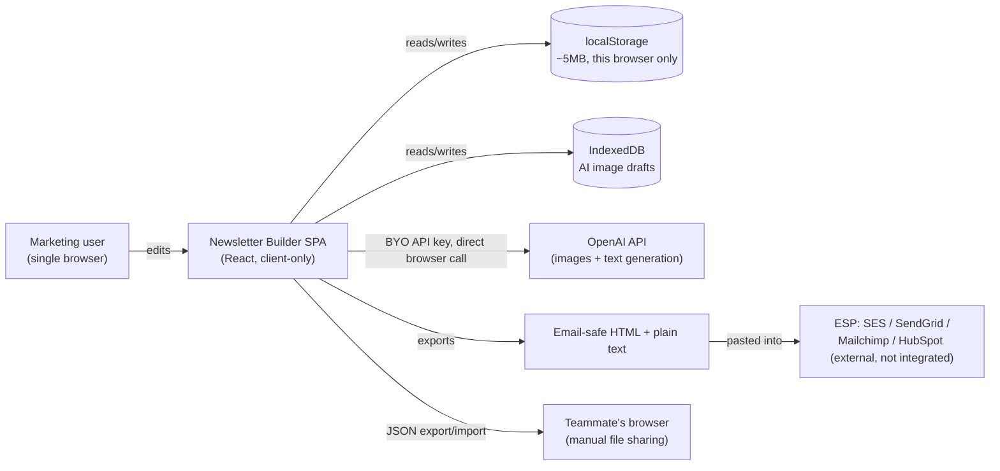
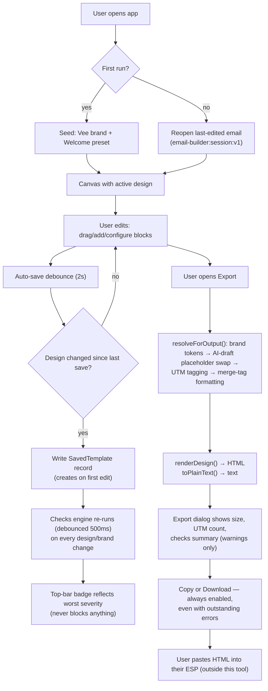
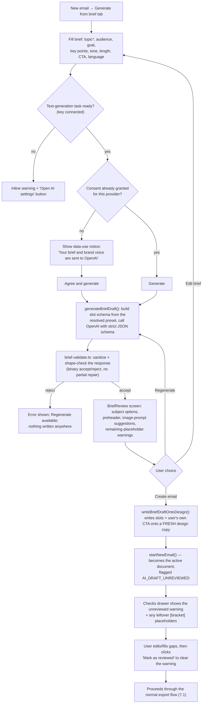
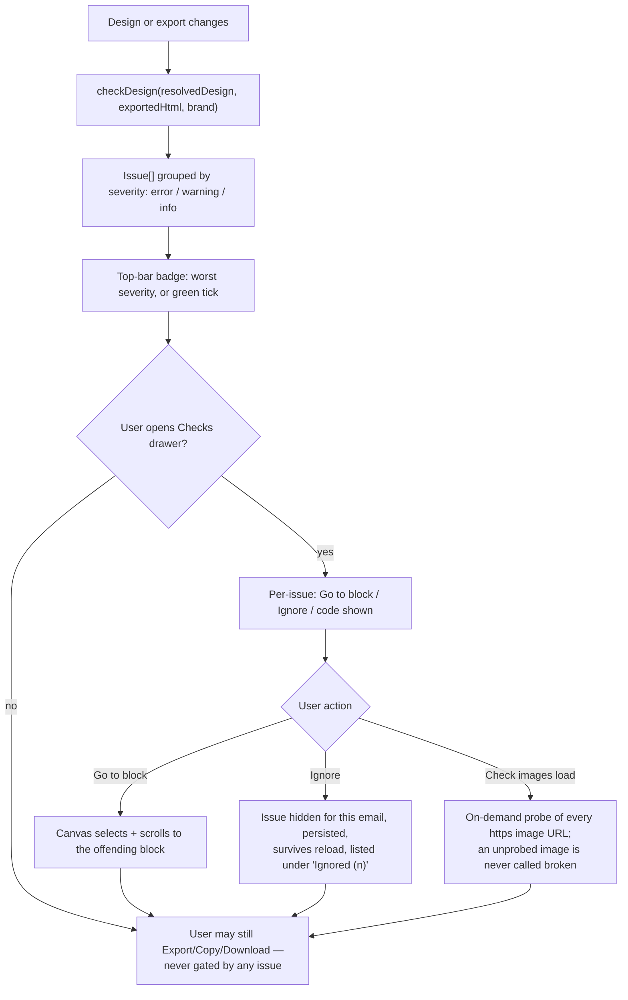

# Newsletter Builder — Business Requirements Document
## Part 1 of 4 — Sections 1–10

> Reverse-engineered from the codebase at `C:\Sasikumar\claude-office\newsletter-builder` (git history `0094008`…`9abc092`, branch `feature/6a-brief-generation`) plus its own `docs/PROGRESS.md` feature log. See `docs/brd/README.md` for the full table of contents and `docs/brd/VERIFICATION_NOTES.md` for every statement below tagged **Inference** or **Not Found in Codebase**.
>
> **Fact vs. Inference vs. Not Found** — every claim in this document is one of three things:
> - **Fact** — stated directly in code, comments, tests, or `docs/PROGRESS.md`, and is the default status of any sentence with no other tag.
> - **Inference:** — a conclusion drawn from code behavior but not stated verbatim anywhere; flagged inline.
> - **Not Found in Codebase** — explicitly looked for and absent; flagged inline rather than guessed at.

---

## 1. Executive Summary

**What the application is.** Newsletter Builder is a **browser-only, single-user, drag-and-drop email template builder** (React 19 + TypeScript + Vite + Tailwind CSS 4). It lets a non-technical marketing user assemble a company newsletter or marketing email visually — rows, columns, and content blocks — and export **email-client-safe HTML** (table-based layout, inline styles, Outlook conditional markup) plus a plain-text alternative, ready to paste into an Email Service Provider (ESP) such as SES, SendGrid, Mailchimp, or HubSpot. (Fact, `README.md`.)

There is **no server, no database, and no login**. Every byte of data — designs, brand kits, saved blocks, the image library, version history, AI provider keys, AI-generated image drafts — lives in the visiting browser's `localStorage` (~5 MB budget) or `IndexedDB`, and nothing syncs between machines or teammates except by manual JSON export/import. (Fact, README "Known limitations"; corroborated across every feature in `docs/PROGRESS.md`.)

**Business purpose.** `docs/PROGRESS.md` states the product is an **"internal tool for the Vee MARCOM team"** (Feature 1A) — i.e., it exists to let a marketing/communications team produce on-brand, email-safe HTML newsletters without a developer or an external design tool in the loop, and (as of Feature 6A) without necessarily writing the first draft of the copy by hand either.

**Target organizations / users.** A single organization's internal marketing/communications function (named explicitly: "Vee Technologies," seeded as the default brand). **Inference:** the architecture (per-browser brand kits, no roles, export/import as the sharing mechanism) suggests the product was built for a small team sharing a few brand kits, not a multi-tenant SaaS audience — this is an inference from the data model, not a stated target-market claim.

**Business problems solved** (each is a named feature below):
| Problem | Feature | Solution |
|---|---|---|
| Newsletters require a designer/developer to hand-code HTML email | 1A–1C, Canvas/renderer | WYSIWYG canvas; one renderer produces both the live preview and the export |
| Re-theming for a different brand means rebuilding the email | 1A | Brand-token resolution: colors/fonts are tokens resolved at export time |
| Common sections (header, hero, article list, footer) rebuilt by hand every time | 1B, 1C | Composite blocks + 8 ready-made presets |
| No visibility into whether an email will actually work in an inbox | 3A (Checks), 2C-1 (image audit) | A non-blocking quality engine checking size, links, contrast, images, subject/preheader |
| Dark-mode inboxes show broken colors | 3B | Per-brand dark palette, additive-only dark CSS |
| Starting a draft from scratch takes too long | 6A | AI-assisted "generate an email from a brief," human-reviewed before anything is written to the design |
| Generating on-brand imagery requires a separate tool | 5A | Bring-your-own-key AI image generation inside the editor |
| Settings/keys/brand management were scattered | 7A | A single Settings hub; a local "profile" display name (not a login) |
| One AI model choice for everything, no fallback | 6B | Per-task (text vs. image) model routing with a configurable fallback chain |

**Key capabilities** (see §9 for full feature documentation): brand kits with light/dark palettes; 13 block types (9 atomic + 4 composite); 8 starter presets; drag-and-drop canvas with undo/redo; merge tags with 4 ESP output formats; UTM link tagging; plain-text generation; auto-save, version history, and a saved-blocks library; a URL-based image library; a non-blocking email-quality "Checks" engine; dark-mode export; AI image generation (OpenAI, bring-your-own-key); AI "generate email from a brief" with mandatory human review; per-task AI model routing with fallback chains; a Settings hub covering profile, AI, brands, email defaults, checks, and data backup/restore.

**Expected business outcomes:** faster newsletter production, consistent on-brand output across emails, fewer broken-in-the-inbox sends (via Checks), and a lower skill floor for producing a first draft (via AI brief generation) — all **Inference**, since the codebase states the mechanisms but not measured outcomes; no KPI/analytics instrumentation exists in the codebase (see §3).

**High-level business architecture.**

**Value proposition.** One tool that both builds the email (design-time) and proves it is inbox-safe (Checks, image audit, dark-mode additive guarantee) before a human ever pastes it into a sending tool — without requiring a backend, an account system, or ongoing hosting costs, at the cost of no cross-device sync and no true multi-user collaboration. (Fact + Inference as to "value proposition" framing.)

---

## 2. Business Overview

**Why this application exists.** `docs/PROGRESS.md` frames each feature around a concrete, named operational pain point rather than an abstract roadmap item. Representative quotes:
- 1A: brand/theme management was manual, with "no roles, membership or login" needed yet seams left for later.
- 2B: "closing a tab lost whatever was not explicitly saved, there was no way back once the undo stack was gone, and a CTA band built once had to be rebuilt by hand next time."
- 2C-1: "Images were the weakest part of the builder: every URL typed by hand... nothing telling you an image was broken, low-resolution or still preset stock art until it reached an inbox."
- 3A: "One engine that reads what is actually sent and says what an inbox will do with it."
- 6A: turning "a structured content brief into a fully-populated draft email... with a human review step before anything is written to the design."
- 7A: settings "scattered" across the top bar and a panel gear icon, with no storage-usage visibility or backup.

**Current business challenges (addressed).** Hand-coded email HTML is fragile across clients (Outlook/Gmail/Apple Mail render differently); marketing copy drafting is slow; brand consistency across campaigns is hard to enforce by hand; nothing warned a sender before a send that an email would be clipped, broken, or inaccessible.

**Business opportunities.** AI-assisted first-draft generation (6A) and AI image generation (5A) shorten the time from "we need an email about X" to a reviewable draft. Per-task model routing (6B) lets the team choose cost/quality trade-offs independently for text vs. image generation and add resilience via fallback chains.

**Operational problems solved:** version history and auto-save remove the "I lost my work" risk; the saved-blocks library removes "rebuild this CTA band every time"; the image library removes "which URL did we use for that hero image last time."

**Organizational benefits:** a non-developer can produce compliant, on-brand, multi-client-safe HTML without engineering involvement per email.

**Departments involved.** Fact: `docs/PROGRESS.md` names the **"Vee MARCOM team"** (marketing/communications) as the internal user base for Feature 1A. No other department, approval chain, or cross-team workflow is referenced anywhere in the codebase. **Not Found in Codebase:** any other named department (legal, sales, IT, compliance) interacting with the system.

**Business scope.**
| In scope | Not Found in Codebase / explicitly out of scope |
|---|---|
| Visual design of a single HTML email at a time | Multi-email campaign scheduling |
| Brand kit management (colors, fonts, logos, footer, social, voice) | Sending the email (README: "No sending: export the HTML and send it through your ESP") |
| AI-assisted copy and image drafting (BYO API key) | Any backend, server, or managed AI billing — the user is billed directly by OpenAI |
| Email-quality checks (size, links, contrast, images, subject/preheader) | Link-liveness checking beyond classification (checks.ts: "Links are classified, not fetched") |
| Local backup/restore and "clear all" data management | Cross-device sync; multi-user collaboration; login/accounts/roles |
| Merge tags, UTM tagging, plain-text generation at export time | A/B testing, send-time personalization engine, analytics on opens/clicks |

**Out-of-scope items are load-bearing facts, not gaps to be solved later** in several cases — the README explicitly frames "no sending," "per-browser only," and "URL-only images (no upload/hosting)" as *deliberate, current-state* boundaries, not unfinished work. Several (hosting, sending) are flagged as candidate future work in §30.

---

## 3. Business Objectives

**Primary objectives** (Inference, derived from the pattern of shipped features — no objectives/OKR document exists in the codebase):
1. Let a non-developer produce an email-client-safe HTML newsletter without hand-coding.
2. Keep every email visually on-brand with minimal per-email effort (token-based brand resolution).
3. Catch inbox-breaking mistakes (size, broken links, missing alt text, poor contrast, placeholder art) before a human sends, without ever blocking the export.
4. Reduce first-draft effort via AI assistance for both copy (6A) and imagery (5A), always behind a human review/consent step.

**Secondary objectives** (Inference):
5. Protect against data loss (auto-save, version history, undo/redo).
6. Make reuse cheap (saved blocks, image library, presets).
7. Keep AI usage auditable and safe (keys never serialized into exportable state; consent gates; redacted error messages; no silent retries that could double-bill).

**Business KPIs.** **Not Found in Codebase.** There is no analytics, telemetry, or usage-metrics code anywhere in `src/` — no event tracking, no error-reporting SDK, no "time to first email" instrumentation. Any KPI claim here would be invented, so none is stated.

**Success criteria.** **Not Found in Codebase** as a formal acceptance document; however, each shipped feature in `docs/PROGRESS.md` carries its own test-suite-verified acceptance bar (e.g., Feature 3A: "the Export dialog's buttons are live with errors outstanding, by design and by test"). These are implementation-level acceptance tests, not business-level success metrics — see §31 for feature-by-feature Given/When/Then criteria derived from the same source.

**Expected ROI.** **Not Found in Codebase.** No cost model, pricing, or ROI calculation exists in the product. The only cost-relevant facts in-code are: (a) AI generation calls are billed directly by OpenAI to the user's own key — the app has no cost visibility or usage caps (Fact, `ai-features.md` research pass, confirmed by exhaustive grep); (b) the deliberate no-retry policy on AI calls exists specifically "to avoid double-billing" a request that may have already produced and been charged for.

**Business value delivered** (Inference, qualitative): faster time-to-draft; consistent brand application; fewer email-client rendering failures; reduced risk of sending with a broken unsubscribe link, placeholder art, or inaccessible contrast.

---

## 4. Stakeholders

**Not Found in Codebase:** a human stakeholder list, org chart, or RACI document. The stakeholders below are **Inference**, reconstructed from what the product's own seams (`createdBy`/`updatedBy`, permission functions, the single "Profile" display name) imply about who touches the system and how.

| Stakeholder | Role | Responsibilities | Goals | Pain points (addressed) | System interaction | Decision authority |
|---|---|---|---|---|---|---|
| Marketing/Communications team member (the "Vee MARCOM team," per 1A) | Primary/sole end user | Build, review, and export newsletters; manage the team's brand kit(s); optionally generate drafts via AI | Produce on-brand, inbox-safe emails quickly | Manual HTML coding; broken-in-inbox sends; lost work; inconsistent branding | Full access to every screen — there is no restricted view | Full — the only user role that exists |
| Brand owner (Inference — same person or a nearby role, not a distinct system role) | Defines/maintains the brand kit(s) (colors, fonts, logo, footer, voice) | Keep the brand kit accurate and current | Brand consistency across every email | Rebuilding brand styling per email | Brands modal / Settings → Brands | Same technical authority as any user — `canEditBrand()` returns `true` unconditionally today |
| A future "admin"/"owner" role (Inference — a seam, not a shipped role) | Not implemented | N/A | N/A | N/A | `createdBy`/`updatedBy` fields and `canEditBrand`/`getAccessibleBrands` exist as **explicit future-proofing stubs** (1A) | None today — the functions always return "everything"/"true" |
| OpenAI (external, non-human "stakeholder" in the business-process sense) | AI text/image generation provider | Fulfill brief-generation and image-generation requests sent directly from the user's browser with the user's own API key | N/A (external vendor) | N/A | Called directly via `fetch` from the browser (no backend proxy) | None over the product; the product is designed never to send the user's API key anywhere but to this provider |

**Stakeholder matrix (RACI-style, Inference):**
| Activity | Marketing/MARCOM user |
|---|---|
| Build/edit an email | R, A |
| Manage brand kit | R, A |
| Approve an AI-generated draft before send | R, A (the "Mark as reviewed" gate — see §13) |
| Export/send the email | R, A (sending itself happens outside this tool) |
| Back up/restore local data | R, A |

Because there is exactly one functional role, a traditional multi-party RACI collapses to a single column — this is a **Fact about the product's current scope**, not an omission in this document.

---

## 5. User Roles

**Not Found in Codebase: any role beyond a single, undifferentiated user.** `src/lib/user.ts`'s own header comment states the product has **"no login, no roles, an internal tool's substitute for an account."** (Fact.) There is no authentication, no session boundary between "users," and no server-side identity of any kind (confirmed by exhaustive grep for `auth|login|password|session` across `src/` — every hit is either AI-provider API-key handling or in-browser-tab AI session state, never an app login).

### 5.1 The one functional role: "Editor" (unnamed in code; Inference label for this document)

| Attribute | Value |
|---|---|
| Business purpose | Produce and maintain the organization's email newsletters |
| Responsibilities | All of: content authoring, layout, brand management, AI-assisted drafting, quality review, export, local data backup |
| Permissions | Unrestricted — every screen, every action |
| Accessible modules | All (Canvas/editor, Brands, Templates, History, Checks, Image Library, Saved Blocks, AI Image panel, Brief generation, Settings hub in full) |
| Restricted modules | None |
| Approval authority | De facto total — "Mark as reviewed" on an AI-generated draft (§13) is the only formal gate in the product, and the same single role both triggers and clears it |
| Reporting responsibility | None found — no reporting/escalation feature exists |
| Business ownership | The display name set in **Settings → Profile** is stamped as `createdBy`/`updatedBy` on brands and saved emails (7A) — purely a local label, "never sent anywhere," not an access-control mechanism |

### 5.2 "Identity" vs. "role" — a deliberate distinction

`getCurrentUser()` (`src/lib/user.ts`) returns a single free-text display name (default **"Guest"**, capped at 40 characters), used only for the `createdBy`/`updatedBy` attribution fields. It is explicitly **not** an authentication identity: it is not required, not unique, not verified, and not used anywhere to gate access. Two people sharing one browser profile would appear as whichever name was last typed into **Settings → Profile**.

### 5.3 Permissions matrix

| Module / Action | Editor role |
|---|---|
| Edit canvas (blocks, rows, body settings) | ✅ |
| Manage brand kits (create/edit/duplicate/archive/import/export) | ✅ (`canEditBrand()` always returns `true` — Fact, with the function itself documented in-code as a future permission seam) |
| View/switch brand list | ✅ (`getAccessibleBrands()` always returns every active brand — same seam) |
| Generate AI images / AI email drafts | ✅, gated only by: (a) a configured + tested API key, and (b) a one-time per-provider consent checkbox for text generation — **not** by any role |
| Approve ("Mark as reviewed") an AI brief draft | ✅ — the only person who can do this is the same single-role user |
| Manage local data (backup/restore/clear all) | ✅, with a typed-confirmation ("DELETE") safety gate on irreversible deletion — a UX safeguard, not a permission check |

**Not Found in Codebase:** any viewer-only, approver-only, or admin-only role; any concept of "my emails" vs. "someone else's emails" (every saved email in the browser is visible and editable to whoever has the browser open).

---

## 6. Functional Scope

Each function below maps to one or more features documented fully in §9.

| Function | Purpose | Business objective | Trigger | Inputs | Outputs | Dependencies | Users involved | Preconditions | Postconditions |
|---|---|---|---|---|---|---|---|---|---|
| Design a newsletter | Compose the email visually | Fast, accurate authoring | Opening the app / New / Templates | Block type choices, text, images, settings | An in-memory `Design` document | Canvas, LeftPanel, RightPanel, store | Editor | None | `design` mutated; auto-save scheduled |
| Start from a preset | Skip a blank canvas | Faster time-to-draft | "New email" → Presets tab | Brand selection, preset choice | A fresh `Design` built from the chosen preset | `presets.ts`, `NewEmailModal` | Editor | — | New email becomes the active, unsaved-until-first-edit document |
| Generate from a brief | AI-assisted first draft | Faster time-to-draft, consistent tone | "New email" → "Generate from brief" tab | Topic, audience, goal, key points, tone, length, CTA, language, optional source text | A reviewable `BriefDraft` (not yet written to any design) | `create-from-brief.ts`, `slots.ts`, OpenAI text API | Editor | A connected text-generation key; one-time consent | Draft appears in `BriefReview`; nothing persisted until "Create email" |
| Manage brand kits | Central source of visual identity | Brand consistency | Brands modal / Settings → Brands | Colors, fonts, logos, footer, social links, voice guidance | A `Brand` record | `brand.ts`, `BrandsModal` | Editor | — | Brand available in every brand switcher across the app |
| Generate AI images | On-brand imagery without a separate tool | Faster asset creation | AI image panel (opened from an image field) | A text prompt, aspect, style preset, quality | A local image "draft" (IndexedDB bytes + an id) | `openai.ts` (image adapter), `drafts.ts` | Editor | A connected image-generation key | Draft usable on canvas; exports as placeholder until hosted externally |
| Run quality checks | Catch inbox-breaking issues before send | Fewer broken sends | Automatic (debounced) + on demand ("Check images load") | The resolved design + rendered HTML | A list of `Issue`s, grouped by severity | `checks.ts`, `contrast.ts`, `image-audit.ts` | Editor | — | Badge/drawer reflect current issues; never blocks export |
| Export the email | Produce the deliverable | Hand off to an ESP | "Export" button | The design, active brand, UTM/merge-tag settings | HTML and plain-text strings (Copy/Download) | `output.ts`, `render.ts`, `plaintext.ts` | Editor | — | Nothing persisted by export itself |
| Save / auto-save | Protect against data loss | No lost work | Any edit (2s debounce) or explicit "Save version" | The current design | A `SavedTemplate` record / `VersionRecord` snapshot | `storage.ts`, `versions.ts` | Editor | — | Record created/updated; top-bar status updated |
| Manage saved blocks | Reuse content across emails | Less rebuilding | "Save as block" on a selected block/row | A block or row payload | A `SavedBlock` library entry | `blocks-library.ts` | Editor | — | Entry available in the Saved tab across every email |
| Manage the image library | Centralize vetted image URLs | Consistency, fewer broken images | Images tab / any image field's picker | A public https URL | A `LibraryImage` record | `image-storage.ts`, `image-audit.ts` | Editor | URL passes https/malformed checks | Available via picker on every image field |
| Configure AI | Connect and route AI providers | Controlled AI spend/behavior, resilience | Settings → AI | API key, per-task model/provider/fallback choice | Stored key(s) (opt-in) + per-task routing config | `key-store.ts`, `tasks.ts`, `task-settings.ts` | Editor | — | Tasks (`text.brief`, `image.generate`) become "ready" |
| Back up / restore / clear local data | Data portability and recovery | Avoid total data loss; move between browsers | Settings → Data & storage | A backup JSON file, or the typed word "DELETE" | A downloaded JSON file / an overwritten local state / a wiped local state | `backup.ts`, `clear-all.ts` | Editor | For restore: a valid backup JSON; for clear-all: typed confirmation | Local state replaced or wiped; app reloads |

---

## 7. Complete Business Process

Because there is no multi-party approval chain, "business process" here means the **in-browser editorial workflow** — the closest analogue to a BPMN approval flow is the AI-brief human-review gate (6A) and the quality-check gate (3A), both of which are advisory rather than blocking.

### 7.1 Primary process — compose and export an email (happy path)

### 7.2 Alternate path — AI-assisted draft (6A), human review mandatory

**Business validation points:** topic required and total brief length ≤4000 chars; CTA URL must be `https://` if supplied; a response exceeding any field's character budget is rejected outright (no partial acceptance).

**Decision points:** Auto vs. explicit preset selection (goal→preset mapping, §13); consent granted vs. not; draft accepted vs. rejected by validation; human "Create" vs. "Regenerate" vs. "Edit brief."

**"Approval":** the closest the product has to an approval step is the **`AI_DRAFT_UNREVIEWED`** check (a non-blocking warning) cleared by the same single user clicking **"Mark as reviewed."** There is no second-person sign-off anywhere in the codebase — **Not Found in Codebase.**

**Failure/exception paths:** provider/network failure → `AiError` surfaced with a redacted message (never the API key) and, for certain error classes, a configured fallback model is tried next (6B); a validation failure is always a full rejection with a "Regenerate" affordance, never a silent partial write.

**Retry behavior — explicitly NOT automatic:** both AI pipelines (image generation, brief generation) make **exactly one request per user action**; the product deliberately removed an earlier auto-retry because it "risked double-billing" — any further attempt requires an explicit user action (Regenerate) or a user-configured fallback chain (6B), never a silent same-request retry.

### 7.3 Alternate path — quality-check remediation (3A, non-blocking by design)

---

## 8. Module Documentation

| Module | Business purpose | Business owner | Users involved | Inputs | Outputs | Dependencies | Approval process | Notifications | Reports | Related modules |
|---|---|---|---|---|---|---|---|---|---|---|
| **Canvas / Editor core** | Visual composition of the email | Editor (sole role) | Editor | Block/row operations | Mutated `Design`, undo/redo history | `store.ts`, `render.ts`, `design-ops.ts` | None | Toast messages on actions | None | All others |
| **Brand kit** | Central visual identity (colors, fonts, logo, footer, social, voice) | Editor | Editor | Brand field edits | `Brand` record; resolved tokens at render time | `brand.ts`, `dark.ts` | None (`canEditBrand` always true) | None | Live kit preview in the Brands modal | Presets, Checks (dark contrast), AI brief (voice) |
| **Presets** | Ready-made starting structures | Editor (consumer only — presets are code, not user-editable) | Editor | Brand selection | A fresh `Design` | `presets.ts`, `defaults.ts` | None | Toast on apply | None | New Email modal, Brief generation (resolves onto a preset) |
| **Brief generation (6A)** | AI-assisted first-draft copy | Editor | Editor | Brief fields, brand voice | A reviewable draft; eventually a `Design` + `BriefRecord` | `create-from-brief.ts`, `slots.ts`, `brief-validate.ts`, OpenAI text API | Human "Mark as reviewed" (non-blocking) | Inline validation/error messages | None | Presets, Checks (`AI_DRAFT_UNREVIEWED`, `BRIEF_PLACEHOLDER_LEFT`) |
| **AI image generation (5A)** | On-brand imagery without leaving the editor | Editor | Editor | Prompt, aspect, style, quality | A local draft image (IndexedDB) | `openai.ts`, `validate.ts`, `drafts.ts` | None | Inline error cards with redacted diagnostics | None | Checks (`AI_IMAGE_MISSING_DRAFT`/`AI_IMAGE_NOT_HOSTED`), Image fields |
| **AI provider/key management** | Securely connect to OpenAI | Editor | Editor | API key(s) | Stored (opt-in) key record; connection status | `key-store.ts` | "Test and save" gate (key only stored once proven) | Status chip (Not configured / Configured / Connected) | None | AI image, Brief generation, Settings → AI |
| **Per-task AI model routing (6B)** | Independent model choice per capability, with fallback | Editor | Editor | Provider/model/options/fallback choices per task | A `TaskRoute` per task | `tasks.ts`, `task-settings.ts`, `run-task.ts` | None | Status chip; "No access to `<model>`" denial chip | None | AI image, Brief generation |
| **Checks (quality engine, 3A)** | Non-blocking inbox-safety review | Editor | Editor | Resolved design + exported HTML | `Issue[]` | `checks.ts`, `contrast.ts`, `image-audit.ts` | None (never blocks) | Top-bar badge; drawer | None (the drawer itself is the "report") | Export, Image library, Dark mode, Brief generation |
| **Image library (2C-1)** | Centralized vetted image URLs | Editor | Editor | Pasted https URLs | `LibraryImage[]` | `image-storage.ts` | None | Load-probe badges ("Could not load") | None | Checks, every image-bearing block field |
| **Saved blocks library (2B)** | Reusable content blocks/rows | Editor | Editor | A selected block/row + name/category | `SavedBlock[]` | `blocks-library.ts` | None | Toasts on save/import/overwrite | None | Canvas, Export/Import JSON |
| **Auto-save / version history (2B)** | Prevent data loss; enable "undo across sessions" | Editor | Editor | Every design change | `SavedTemplate` updates; `VersionRecord` snapshots | `storage.ts`, `versions.ts` | None | Top-bar save status (incl. "storage full") | Storage usage readout | Templates modal, History modal |
| **Export / merge tags / UTM / plain text (2A)** | Produce the shippable deliverable | Editor | Editor | Design, brand, merge/UTM settings | HTML + plain text | `output.ts`, `merge.ts`, `utm.ts`, `plaintext.ts`, `render.ts` | None | UTM tagged/skipped count; checks summary | None | Checks, Dark mode |
| **Dark mode (3B)** | Correct appearance in dark-mode-aware email clients | Editor | Editor | Brand dark palette (or derived) | Additive dark CSS in the export | `dark.ts`, `output.ts` | None | `DARK_NO_LOGO`/`DARK_IMAGE_MANUAL`/`SIZE_DARK_OVERHEAD` checks | None | Brand kit, Checks, Preview |
| **Settings hub (7A)** | Single home for configuration | Editor | Editor | — | — | `SettingsHub.tsx` + 7 section components | Danger-zone "type DELETE" gate | — | None (a shell over the modules above) | Profile, AI, Brands, Email defaults, Checks, Data & storage, About |
| **Profile (7A)** | Local "who is this" label | Editor | Editor | Display name | `createdBy`/`updatedBy` attribution | `user.ts` | None | One-time "Set your name →" hint | None | Brand kit, Templates |
| **Data & storage / backup (7A)** | Portability and recovery of local state | Editor | Editor | A backup JSON, or typed "DELETE" | A downloaded JSON / overwritten or wiped local state | `backup.ts`, `clear-all.ts` | Typed-confirmation gate on delete | Storage usage bar; import summary | Storage usage bar | All persisted modules except AI keys/drafts/consent (deliberately excluded) |

---

## 9. Feature Documentation

Each feature below is drawn directly from `docs/PROGRESS.md`'s own acceptance narrative, cross-checked against source.

### 9.1 Feature 1A — Brand kit + brand switcher
- **Business Purpose:** Let the team re-theme any email instantly without touching its content.
- **Description:** A `Brand` entity (colors, fonts, button style, logo pairs, footer, social links) resolved into the design at render time.
- **Business Need:** Multiple campaigns/sub-brands must look consistent without manual recoloring per email.
- **Actors:** Editor.
- **Trigger:** Opening the Brands modal / switching the brand selector in the top bar or New-email dialog.
- **Preconditions:** None (a seed "Vee Technologies" brand exists on first run).
- **Workflow:** Create/edit a brand → fields stored as `Brand.tokens` → every color/font field in a design stores either a brand token (`"brand.primary"`) or a literal override → `resolveDesign(design, brand, mode)` replaces tokens with literals immediately before render/export.
- **Validation Rules:** Brand name required to save; logo upload ≤2MB, downscaled to 400px wide, types png/jpeg/svg+xml/webp.
- **Business Rules:** Switching brands changes only `design.brandId` — manual overrides survive; "Reset to brand" rewrites the 5 body-level tokens; token resolution order is active brand → seed brand → `''` ("inherit"); exports always use the hosted `logo_url`, never the uploaded preview logo (email clients strip `data:` URIs).
- **Exception Cases:** A `brandId` pointing at an archived/deleted brand silently falls back to the default brand.
- **Outputs:** A themed `Design`; a resolved, token-free export.
- **Notifications:** Toast on save/duplicate/import.
- **Dependencies:** `dark.ts` (dark palette derivation), every renderer that consumes color/font fields.
- **Related Features:** 1B (composite blocks consume brand footer/social/logo), 3B (dark palette), 6A (brand voice).

### 9.2 Feature 1B — Composite blocks (Header, Hero, Footer, Article list)
- **Business Purpose:** Stop newsletters being hand-assembled from atomic blocks for every common section.
- **Workflow:** Each composite block internally builds a throwaway sub-block (menu/social/button) and renders it through the real atomic renderer — no duplicated HTML logic.
- **Business Rules:** A block can never paint edge-to-edge (wrapped in a content-width container); Header/Footer have an "Extend background full width" switch that writes color onto the parent row instead (last-writer-wins if two such blocks share a row); Hero's centered background image uses `<td background>` (no VML — Outlook/Windows shows the fallback color only); `showFooter` (default on) hides Footer blocks from preview/export only, while the canvas keeps them visible at reduced opacity with a "Hidden on send" badge; Hero card count tracks the chosen layout (2 for `cards-2`, 3 for `cards-3`), padding/trimming automatically on layout change.
- **Validation Rules:** Image `alt` text is required in the editor (red asterisk + warning) because inboxes block images by default.
- **Exception Cases:** Pre-1B saved designs are migrated with `showFooter: true` defaulted.
- **Related Features:** 1C (presets compose these four), 2C-1 (image fields on these blocks get the picker/audit).

### 9.3 Feature 1C — Starter presets
- **Business Purpose:** Give "New email" a useful starting point instead of a blank canvas.
- **Workflow:** "New email" → Presets tab → pick Blank or one of 8 presets (Newsletter, Promotional, Product launch, Welcome, Cold outreach, Event invitation, Order confirmation, Weekly digest) → a themed, fresh-id copy is built and becomes the active document.
- **Business Rules:** Every preset is brand-neutral (colors/fonts as tokens); the brand **name** is interpolated into prose once at apply time, then becomes ordinary editable text (a later brand switch re-themes colors but not that wording); every preset ships placeholder art/copy **on purpose**, specifically so the `IMAGE_PLACEHOLDER`/`LINK_PLACEHOLDER_DOMAIN` checks visibly flag it until replaced.
- **Outputs:** A live, real-HTML thumbnail per preset, themed with whichever brand is selected in the dialog.
- **Related Features:** 1B (composition source), 6A (presets are the structural target of brief generation), 3A (placeholder checks).

### 9.4 Feature 2A — Merge tags, UTM tagger, plain text
- **Business Purpose:** Make an exported email ESP-ready, trackable, and accessible without an HTML client.
- **Workflow:** Content always stores canonical `{{tag}}` merge syntax; at export, `resolveForOutput()` applies (in order) brand resolution → AI-draft placeholder swap → UTM tagging (export mode only) → ESP tag reformatting → render/plain-text.
- **Business Rules:** 6 built-in merge tags (`first_name`, `last_name`, `company`, `email`, `unsubscribe_url`, `view_in_browser_url`) map to real Mailchimp/HubSpot field syntax, not a naive transform; UTM tagging is off by default, applies at export only, never overwrites an existing `utm_*` param, and skips non-http(s) links, merge-tag-only URLs, the unsubscribe/view-in-browser links, and any link with its own opt-out flag; per-link opt-out (`noTrack`) is always stripped from the exported HTML, whether UTM is on or off; plain text wraps at 72 characters, never splitting a URL across lines.
- **Outputs:** Export dialog with HTML | Plain text tabs, each with Copy/Download; a UTM "tagged N, skipped M" summary.
- **Related Features:** Checks (`UNSUBSCRIBE_MISSING`, link rules operate on the same resolved/exported pair).

### 9.5 Feature 2B — Saved blocks, auto-save, version history
- **Business Purpose:** Remove the "lost work" and "rebuild it again" risks.
- **Workflow:** Every edit marks the email dirty and restarts a 2-second auto-save debounce, which creates the record on first edit; version snapshots are taken automatically (≤1 per 5 minutes of active editing), manually ("Save version"), and immediately before any restore or canvas replacement; the last 20 versions per email are kept, oldest pruned first; a "Save as block" action freezes a block/row payload into a searchable library, re-themeable per active brand (tokens kept as tokens).
- **Business Rules:** Restoring a version snapshots the present first, so a restore is itself always reversible; inserting a saved block always mints fresh ids (`cloneWithNewIds`), so the inserted copy can never alias the library original; storage write failures are never silent — the user sees "Not saved: storage full," and the app's quota-recovery strategy sacrifices old version snapshots first, never brand/template/image data.
- **Related Features:** Templates modal, History modal, Data & storage (backup/restore of the same records).

### 9.6 Feature 2C-1 — URL-based image library
- **Business Purpose:** Stop broken/inconsistent/un-vetted images from reaching an email.
- **Workflow:** Paste one or more public https URLs → each is validated (scheme, shape) and probed (does it actually load) → accepted entries get a name, default alt text, tags, and optional brand scope → a picker button appears on every one of 12 image-bearing fields app-wide, filling both the URL and its default alt text.
- **Business Rules:** File upload is deliberately refused ("Upload needs image hosting. Paste a public https image URL instead.") rather than silently falling back to an embedded `data:` URI, because most inboxes strip those; a structural problem (not-https, missing alt, placeholder pattern) is reported instantly, but a "broken" verdict requires an explicit "Check images load" probe — an unexamined image is never accused.
- **Related Features:** Checks (shares the same audit data), every block with an image field, Brand logo fields.

### 9.7 Feature 3A — Checks (quality engine)
- **Business Purpose:** Tell the sender, before they send, what an inbox will actually do with this email — without ever stopping them from sending anyway.
- **Workflow:** `checkDesign(resolvedDesign, exportedHtml, brand, opts)` runs on the exact pair the Export dialog itself builds, debounced 500ms, also re-run on a whole-design load.
- **Business Rules (full catalogue in §13):** size vs. Gmail's ~102KB clip; dead/insecure/placeholder-domain links; missing unsubscribe text; empty/over-long subject and preheader; WCAG AA contrast (text, buttons, links, light and dark); text under 12px; buttons under a 44px tap target; thin/image-only content; every image-quality rule; AI-draft-specific rules (missing/unhosted draft, unreviewed brief, leftover brief placeholders).
- **Exception Cases:** Text sitting on a hero background image is explicitly reported as "unknown," never guessed at.
- **Outputs:** A severity-grouped drawer with per-issue "Go to block"/"Ignore," and a top-bar badge.
- **Related Features:** Every content/export feature feeds into this engine; none of them can be blocked by it.

### 9.8 Feature 3B — Dark mode support
- **Business Purpose:** Correct appearance in dark-mode-aware clients (Apple Mail, Outlook Mac/iOS, Outlook.com) without breaking light mode.
- **Workflow:** The design is resolved twice — once against the real brand, once against a dark-palette-swapped brand — and the two renders are diffed: a value that moved came from a brand token (gets a CSS class); a value that stayed was a hand-typed hex (stays exactly as typed). A manual per-block/per-row override beats both.
- **Business Rules:** Fully additive — with the toggle off, the export is byte-identical to a pre-dark-mode export (no meta tags, no stylesheet, no class names); two hand-corrected role-mapping cases exist (an "ink" color used as a background must not flip to light text; a "surface" color used as a label must resolve to whatever actually reads on its real background) because brand kits name colors by identity, not role.
- **Exception Cases:** Gmail's own mail apps ignore all of this and apply their own inversion (explicitly noted in the Preview UI); a hero background image cannot be restyled for dark mode at all (`DARK_IMAGE_MANUAL` info).
- **Related Features:** Brand kit (dark palette fields), Checks (dark-specific contrast rules), Preview.

### 9.9 Feature 5A — AI image generation (bring-your-own key, with 4 amendments)
- **Business Purpose:** Generate on-brand images for an email without leaving the editor or paying for a separate tool/subscription.
- **Workflow:** Open the AI image panel from any of 5 image-bearing field types → describe the image, choose aspect/style/quality → one request to OpenAI's image endpoint → the result becomes a local "draft" (bytes in IndexedDB, only an id in the design) → "Use this image" requires alt text before it can be placed on canvas.
- **Business Rules:** Exactly one request per generation, never retried automatically (a failed-but-maybe-successful call "may already have been produced and billed"); the response is validated by magic bytes, not declared content-type, SVG is refused outright (can carry script), max 10MB; the API key defaults to in-memory-only (dies with the tab) and is never written into any serializable app state (swept by dedicated tests across every export/backup surface); because no image hosting exists, every export of a generated image ships a visible placeholder URL until the user manually hosts the PNG elsewhere and pastes the resulting URL in.
- **Exception Cases:** `AI_IMAGE_MISSING_DRAFT` (the browser doesn't hold the bytes — e.g., an imported design) vs. `AI_IMAGE_NOT_HOSTED` (the bytes exist locally but nowhere public) are two distinct, mutually exclusive checks, both reported only after the app has actually looked.
- **Related Features:** 6B (per-task model routing supersedes this feature's own single-provider model picker), Checks, Image fields.

### 9.10 Feature 6A — Generate an email from a brief
- **Business Purpose:** Produce a reviewable first-draft email from a short structured brief instead of a blank canvas or a hand-written draft.
- **Workflow:** Full BPMN-style flow in §7.2. Key mechanic: the set of AI-fillable fields ("slots") is **derived by walking the actual block tree** of the resolved preset and classifying by block type — not hand-written per preset — so all 8 presets are supported automatically and a 9th preset would be too.
- **Business Rules:** A field is AI-required exactly when the preset's own placeholder copy for it is non-empty (the preset author's choice to fill it in is itself the signal that it matters); AI is categorically excluded from footer/legal copy, structural blocks, logos, and the hero background image; if the user supplies their own CTA label, the AI is never even asked for one; the model's output is validated by a strict JSON Schema (`additionalProperties: false`, every field explicitly required-or-nullable) as a mechanical defense against prompt injection, on top of explicit delimiter-wrapped "this is data, not instructions" framing in the system prompt; validation is binary (accept the whole response or reject it with a reason) — no partial repair.
- **Exception Cases:** Bracket placeholders like `[add date]` are deliberately left alone by the sanitizer — they are the intended signal to the human that a fact was missing from the brief.
- **Outputs:** A `BriefDraft` (subject options, preheader, slot values, image-prompt suggestions) reviewed in `BriefReview` before anything is written to any design.
- **Related Features:** Presets (structural target), Checks (`AI_DRAFT_UNREVIEWED`, `BRIEF_PLACEHOLDER_LEFT`), 6B (model routing), Brand kit (voice guidance consumed here).

### 9.11 Feature 6B — Per-task AI model routing (+ amendment)
- **Business Purpose:** Let text generation and image generation use independently chosen models, with resilience via a configurable fallback chain, instead of one global "active provider."
- **Workflow:** Settings → AI → "Models per task" — one row per task (`text.brief`, `image.generate`), each with its own provider/model pick (or a free-typed model id), its own quality/temperature option, its own "Test connection," and its own ordered fallback list.
- **Business Rules:** A fallback candidate is tried only on a `network`/`timeout`/`rate-limit`-classified failure — never on a bad key, no-credit, content-policy refusal, or malformed response, because "a different model on the same account wouldn't fix any of those"; a candidate with no configured key is skipped; a per-generation Quality selector in the chat UI always wins over the task's configured default quality (a regression caught before shipping); defaults were reverted in the 6B amendment to "a model the user actually chose" (`gpt-4.1-mini` / `gpt-image-2`) rather than whatever is newest, though newer ids remain selectable.
- **Exception Cases:** A session-only, per-task "this model was just refused" flag (`model-access.ts`) swaps the status chip to "No access to `<model>`" and persists the warning until the model is changed and changed back.
- **Related Features:** 5A, 6A (both now call `runTask()` rather than hardcoding a provider/model), Settings hub.

### 9.12 Feature 7A — Profile bar and Settings hub
- **Business Purpose:** Consolidate previously scattered configuration (brand switcher only in the top bar, AI keys buried in a side-panel gear icon, no storage visibility, no backup) into one place, and give the product a local "who is this" identity substitute for an account.
- **Workflow:** A left-panel "Settings" gear opens a two-level hub (section list → section detail, Escape navigates back one level at a time) with 7 sections: Profile, AI, Brands, Email defaults, Checks, Data & storage, About.
- **Business Rules:** "Email defaults" apply **only** to a brand-new email at the moment of creation — never to an already-open or already-saved email, by construction (one function called from exactly 3 design-creation sites); "Clear all local data" requires literally typing the word `DELETE` before the button enables, and clears AI keys and IndexedDB drafts along with everything else; "Export all data" (backup) structurally cannot reach the AI key store or drafts because its own file never imports those modules.
- **Related Features:** Every module above gets a home here; Brands (management), AI (keys + routing), Data & storage (backup/restore of everything else).

---

## 10. Screen Documentation

All navigation is **client-side React state** — there is **no URL router** (confirmed: `App.tsx` uses a `ModalName` union plus component state, not `react-router` or any history-API usage). Every "screen" below is therefore a **modal, side panel, or in-place view**, not a route, and there are no deep-linkable URLs. (Fact.)

| Screen / Component | Type | Business purpose | Opened from | Key fields | Buttons / actions | Validation shown | Navigates to |
|---|---|---|---|---|---|---|---|
| **Editor shell** (`App.tsx`) | Root layout | Hosts every other screen | App load | — | Keyboard shortcuts (Ctrl+Z/Shift+Z/Y, Ctrl+D, Delete, Escape) | — | Everything below |
| **Top bar** (`TopBar.tsx`) | Persistent header | Title, brand switch, undo/redo, device/scheme toggle, save status, all modal launchers | Always visible | Email title, brand selector | New, Templates, History, Import JSON, Download JSON, Export, Checks badge, Preview | Confirms replace if `dirty` before New/Import | New Email, Templates, History, Export, Preview modals |
| **Left panel** (`LeftPanel.tsx`) | Persistent sidebar | Add content; manage saved blocks/images; entry to Settings | Always visible | 4 tabs: Content, Rows, Saved, Images | Tile-click-to-add; drag-and-drop; Settings gear; Profile row | Saved-block import reports duplicates/clashes | Settings hub, Image picker |
| **Canvas** (`Canvas.tsx`) | Main view | WYSIWYG preview = the actual export renderer | Always visible | — | Drag/reorder/select/duplicate/delete | Dimmed "Hidden on send" badge for hidden footers | Right panel (via selection) |
| **Right panel** (`RightPanel.tsx`) | Persistent sidebar | Property editor for the current selection, or email-wide settings when nothing is selected | Always visible (replaced by AI image panel when generating an image) | Varies per block type | Save as block, Duplicate, Delete (block/row); Reset to brand (body) | Per-field (e.g., CTA URL https-only) | AI image panel, Save Block dialog |
| **New email modal** (`NewEmailModal.tsx`) | Modal | Start a new email from a preset or a brief | Top bar "New" | Brand selector; preset grid or brief form | Pick a card; "Generate"/"Create email" | Confirms replace if `dirty` | Brief form/review (embedded), closes into Canvas |
| **Brief form** (`BriefForm.tsx`) | Embedded view (inside New Email modal) | Collect brief inputs | "Generate from brief" tab | Topic*, audience, goal, key points (≤8), tone, length, CTA label/URL, article count, language, preset, source text | Add/remove key point; "Agree and generate" / "Generate" | Topic required; total ≤4000 chars; CTA URL https-only; "needs an OpenAI key" warning if not ready | Brief review |
| **Brief review** (`BriefReview.tsx`) | Embedded view | Human review/approval of the AI draft before creation | After a successful generation | Subject options + editable subject (≤`SUBJECT_MAX_CHARS`), preheader (read-only), image-prompt suggestions | Create email; Regenerate; Edit brief; Copy (per image prompt) | Lists every leftover `[bracket placeholder]` before Create | Canvas (on Create) |
| **Brands modal** (`BrandsModal.tsx`) | Modal | Full brand-kit CRUD | Top bar palette icon / Settings → Brands → "Manage brands" | Identity, Logos, Colors, Dark mode, Fonts, Buttons, Footer, Social links, Voice | New brand, Import JSON, per-brand Export/Duplicate/Edit/Archive/Restore | Name required to save; dark-palette readable-contrast readout | Brand edit form (embedded) |
| **Templates modal** (`Modals.tsx::TemplatesModal`) | Modal | Browse/open/rename/delete saved emails | Top bar "Templates" | Email name field | Rename this email; Save as a copy; Open; Delete | Confirms replace if `dirty`; storage usage bar with low-space warning | Canvas (on Open) |
| **History modal** (`HistoryModal.tsx`) | Modal | Version history browse/restore | Top bar "History" | Optional note field | Save version; Preview; Restore | "No changes since the last version" when nothing changed | Read-only version preview (embedded) |
| **Export modal** (`Modals.tsx::ExportHtmlModal`) | Modal | Produce the final HTML/plain-text deliverable | Top bar "Export" | — | Copy, Download (.html/.txt), "Open checks →" | Checks summary line; UTM tagged/skipped count; size in KB | Checks drawer |
| **Preview modal** (`Modals.tsx::PreviewModal`) | Modal | See the exact exported HTML rendered | Top bar "Preview" | — | Desktop/Mobile toggle, Light/Dark toggle (if dark mode on) | Notes when showing local AI drafts vs. their export placeholder | — |
| **Checks drawer** (`ChecksPanel.tsx`) | Overlay (not a modal — layers over the right panel) | Review/act on quality issues | Checks badge (top bar) or "Open checks →" (export) | — | Go to block; Ignore/Un-ignore; "Check images load" | Groups by severity; "Ignored (n)" section | Canvas (block selection) |
| **AI image panel** (`AiImagePanel.tsx`) | Replaces right panel | Generate/use an AI image for the selected field | Any image field's "Generate with AI" entry point | Prompt, aspect, style, quality, brand-colors toggle | Send/Generate, Cancel, Use this image, Regenerate, Edit prompt, Download PNG | Alt text required before "Add to email"; readiness/settings warning if no key | Settings view (embedded, via gear icon) |
| **AI settings view** (`AiImagePanel.tsx::SettingsView`) | Embedded view (shared by the AI image panel's gear AND Settings → AI) | Manage provider API key(s) | AI panel gear / Settings → AI | API key (masked), Remember-on-device checkbox | Add/Replace key, Test and save, Test connection, Remove key | "Key is only stored once Test connection passes" | Back to chat / back to Settings |
| **Image library** (`ImageLibrary.tsx`) | Embedded view (Left panel "Images" tab) + **Image picker modal** when invoked from a field | Manage/choose vetted image URLs | Left panel tab / any image field's picker button | Search, brand filter (This brand/Shared/All) | Add, Export, Import, per-image Copy URL/Delete | Add flow validates + probes every pasted URL before accepting | Add-images flow (embedded) |
| **Save Block dialog** (`SaveBlockDialog.tsx`) | Modal | Save a selected block/row to the reusable library | "Save as block" (right panel header) | Name* (required), Category (free text, autocompletes known categories) | Save block / Cancel | Warns if the payload embeds a `data:` image | — |
| **Settings hub** (`SettingsHub.tsx`) | Replaces left-panel content | Single home for configuration | Left panel Settings gear / Profile row | — | 7 section rows | — | The 7 sections below |
| **Settings → Profile** (`ProfileSection.tsx`) | Embedded view | Set the local display name | Settings hub | Display name (≤40 chars) | Save | "A display name is required" if empty | — |
| **Settings → AI** (`AiSection.tsx`) | Embedded view | Keys + per-task model routing | Settings hub | Per-task provider/model/option/fallback pickers | Test connection (per task); Reset to defaults; Add/remove fallback | Status chip per task; "No access to `<model>`" denial chip | Opens the shared AI settings view above it |
| **Settings → Brands** (`BrandsSection.tsx`) | Embedded view | Default brand + entry to full brand management | Settings hub | Default brand for new emails (dropdown) | Manage brands | — | Brands modal |
| **Settings → Email defaults** (`EmailDefaultsSection.tsx`) | Embedded view | Org-wide defaults for brand-new emails | Settings hub | Merge format (+ custom prefix/suffix), UTM source/medium, Dark mode toggle | — (auto-saves on change) | Explicit note: "never edits an email you already have open or saved" | — |
| **Settings → Checks** (`ChecksSection.tsx`) | Embedded view | Bulk-reset dismissed warnings | Settings hub | — | Reset for this email (n); Reset for every email | Confirmation dialog before reset | — |
| **Settings → Data & storage** (`DataSection.tsx`) | Embedded view | Backup/restore/clear local data | Settings hub | Delete-confirmation text field | Export all data; Import backup; Clear all local data | Import shows a record-count summary before overwrite; delete requires typing `DELETE` | Reloads the app after import/clear |
| **Settings → About** (`AboutSection.tsx`) | Embedded view | Version + keyboard shortcuts reference | Settings hub | — | Link to project README | — | — |
| **Confirm dialog** (`ConfirmDialog.tsx`) | Global modal (context-provided) | Reusable yes/no confirmation for destructive actions | Any destructive action app-wide | — | Confirm / Cancel | Danger styling when the action is destructive | Returns to caller |

