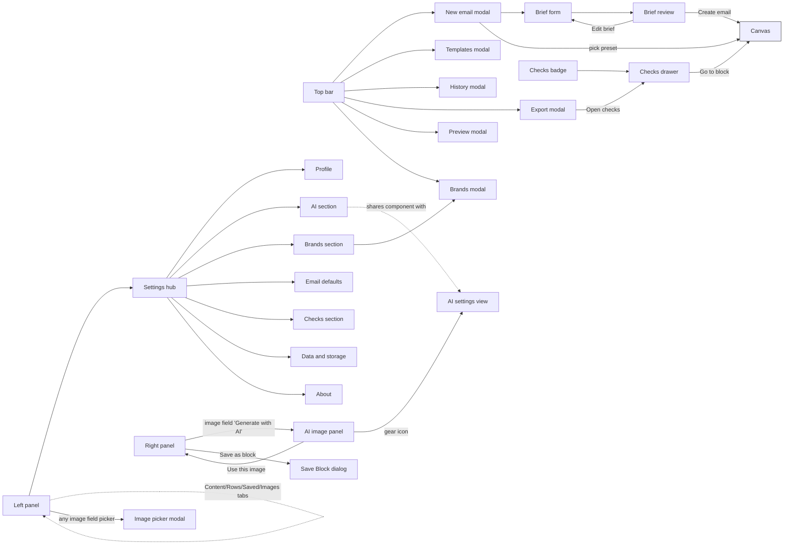
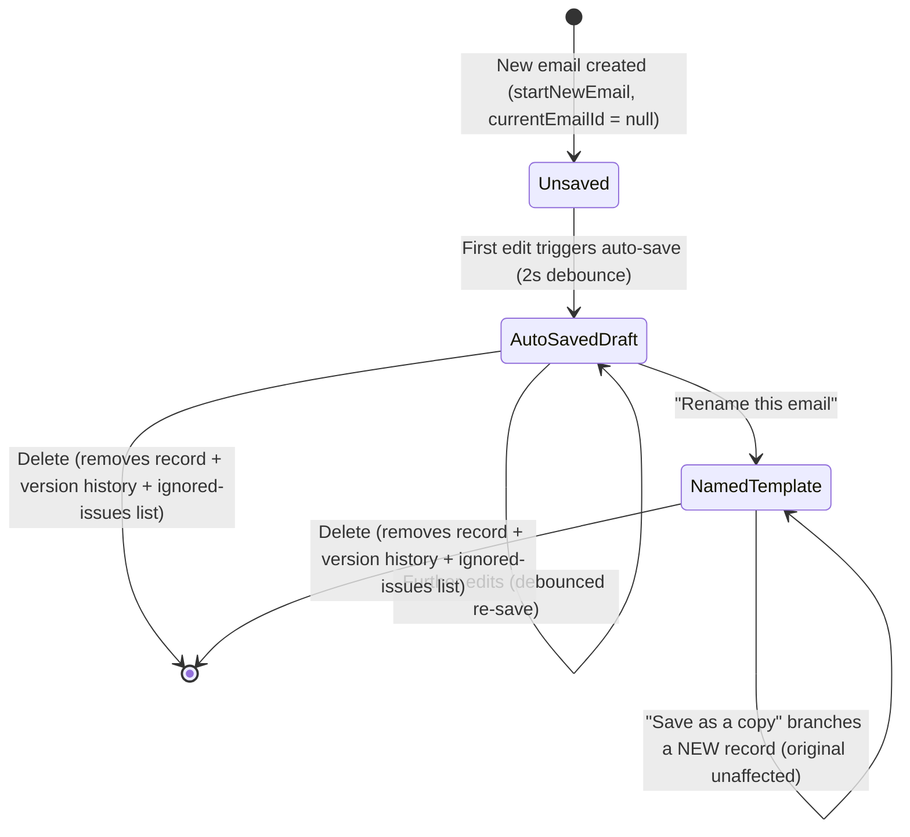
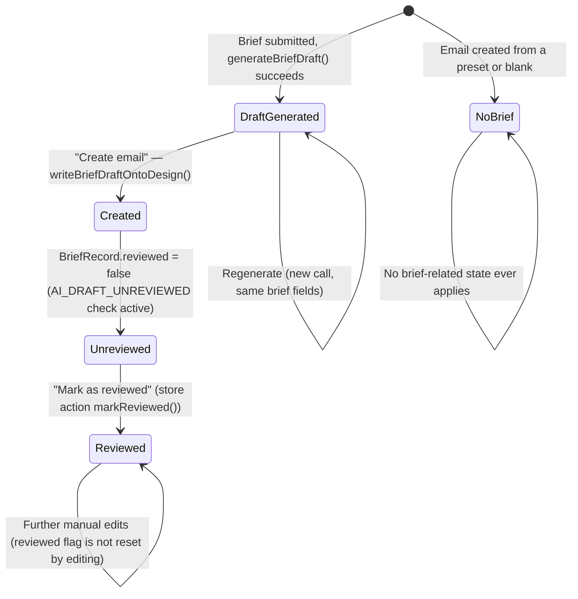
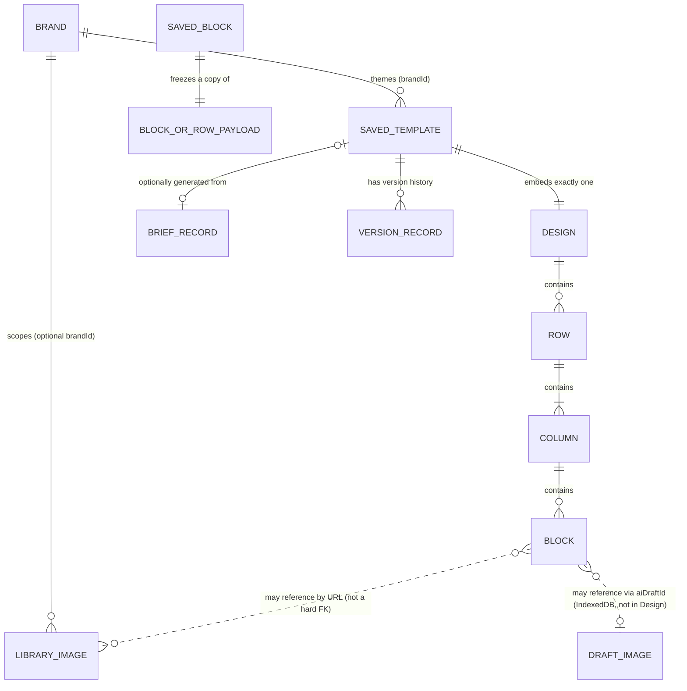

# Newsletter Builder — Business Requirements Document
## Part 2 of 4 — Sections 11–20

> Continues from `BRD-01.md`. See `docs/brd/README.md` for the table of contents and `docs/brd/VERIFICATION_NOTES.md` for the consolidated Inference / Not Found list.

---

## 11. Navigation Flow

There is **no router and no menus/submenus in the traditional sense** — the whole app is one screen with a persistent top bar, left panel, canvas, and right panel, plus modals/overlays layered on top. (Fact — confirmed via `App.tsx`'s `ModalName` union and component state; no `react-router`, no `<a href>` navigation, no browser history entries created by in-app navigation.)

**Role-based navigation: Not Found in Codebase** — every screen is reachable by the single Editor role; there is no conditional menu rendering based on identity.

**Conditional navigation that does exist (Fact):**
- The AI image panel **replaces** the right panel entirely while open (not a modal) — selecting any other block/row underneath is still possible but the properties panel is hidden until "Back."
- The Checks drawer **overlays** (not replaces) the right panel, specifically so a block jumped to from the drawer has its property editor waiting underneath once the drawer closes.
- The Settings hub **replaces** the left panel's tab content; opening it snapshots the previously active tab + scroll position in a ref and restores both on close.
- On narrow viewports (`max-md:`), the Settings hub becomes a full-screen sheet (`fixed inset-0`) — the **only** responsive behavior anywhere in the app's own chrome (Fact, 7A).
- Several cross-component "jumps" exist without any prop-drilling, via a shared module-level callback registry pattern: `registerAiPanel`/`registerImagePicker` (5A, in `fields.tsx`) and `registerSettingsOpener` (6B, in `settings-nav.ts`) — e.g., the Brief form's "Open AI settings" button closes the New Email modal first (since it covers the whole screen) and then opens Settings → AI directly.

**Hidden pages: Not Found in Codebase** — nothing is hidden-but-reachable by URL; there is no URL surface at all.

**Redirects: Not Found in Codebase** — there is no routing layer to redirect within.

### 11.1 Navigation diagram (edges = "X opens Y")



---

## 12. User Journey

There is one role, so journeys are scoped by **task**, not by persona. Each is the full, runnable path through the screens in §10.

### 12.1 Journey — first-time setup and first email
```
App load (no prior data)
  ↓
Seed data created: default "Vee Technologies" brand + a Welcome preset design
  ↓
Canvas shown with the seeded design
  ↓
User edits text/images/blocks
  ↓
Auto-save creates the first SavedTemplate record (2s after first edit)
  ↓
(Optional) User opens Settings → Profile, sets a display name
  ↓
User opens Export, copies/downloads the HTML
  ↓
Completion: HTML pasted into the team's ESP (outside this tool)
```

### 12.2 Journey — AI-assisted email from a brief
```
Top bar "New" → New Email modal → "Generate from brief" tab
  ↓
Fill brief fields (topic required)
  ↓
Business Validation: total brief length ≤4000 chars, CTA URL https-only
  ↓
Decision Point: text-generation task ready? → if not, "Open AI settings" and configure a key first
  ↓
Decision Point: consent already granted? → if not, data-use notice shown, "Agree and generate"
  ↓
Generate → model call → brief-validate.ts shape/sanitization check
  ↓
Business Rule: binary accept/reject, no partial repair
  ↓
Brief Review screen: choose/edit subject, read preheader, copy image prompts
  ↓
Approval-equivalent: "Create email" (or Regenerate, or Edit brief)
  ↓
Data Update: writeBriefDraftOntoDesign() onto a fresh Design; email flagged AI_DRAFT_UNREVIEWED
  ↓
Notification: Checks drawer shows the unreviewed warning + any leftover [bracket] placeholders
  ↓
User fills gaps, clicks "Mark as reviewed"
  ↓
Completion: proceeds through the normal export journey (12.1, from "User opens Export")
```

### 12.3 Journey — generate and use an AI image
```
Select an image-bearing field → "Generate with AI"
  ↓
AI image panel replaces the right panel
  ↓
Decision Point: image-generation task ready? → if not, inline warning + "Open AI settings"
  ↓
Type a prompt, choose aspect/style/quality, optionally toggle brand colors
  ↓
Send (Enter, or the send button) → one request, no auto-retry
  ↓
Business Rule: result becomes a local "draft" — bytes in IndexedDB, only an id in the design
  ↓
User enters alt text (required) → "Add to email"
  ↓
Data Update: the field's aiDraftId is set; refreshDrafts() updates Checks' "known drafts" set
  ↓
Notification (Checks): AI_IMAGE_NOT_HOSTED warning — the export will ship a placeholder until hosted
  ↓
Completion: user downloads the PNG and pastes a real hosted URL into the field later, clearing aiDraftId
```

### 12.4 Journey — brand management and re-theme
```
Top bar palette icon (or Settings → Brands → "Manage brands") → Brands modal
  ↓
New brand / Edit existing → Identity, Logos, Colors, Dark mode, Fonts, Buttons, Footer, Social, Voice
  ↓
Business Validation: name required to save
  ↓
Save brand → upsertBrand() stamps createdBy/updatedBy from the current Profile name
  ↓
Switch the active brand (top bar selector, or New Email dialog selector)
  ↓
Data Update: only design.brandId changes — content and any manual hex overrides are untouched
  ↓
Completion: every brand-token-sourced color/font across the open email re-themes instantly
```

### 12.5 Journey — recover from a mistake (undo, version history)
```
In-session mistake → Ctrl+Z (undo) / Ctrl+Shift+Z or Ctrl+Y (redo)
  ↓
(For an older mistake) Top bar "History" → History modal
  ↓
Select a version → Preview (read-only) → Restore this version
  ↓
Business Rule: the current design is snapshotted first, so the restore itself is reversible
  ↓
Completion: canvas replaced with the restored design; Checks re-run automatically
```

### 12.6 Journey — data portability (backup, restore, clear)
```
Settings → Data & storage
  ↓
"Export all data" → downloads one JSON file (brands, templates, saved blocks, images, versions)
  ↓
(On a different browser/machine) "Import backup" → file parsed and shape-validated
  ↓
Notification: a record-count summary shown before anything is overwritten
  ↓
Decision Point: user confirms "Overwrite local data with this backup?"
  ↓
Data Update: importBackup() overwrites the five covered categories; AI key/drafts untouched
  ↓
Completion: app reloads
```

Alternate ending — **destructive path**:
```
Settings → Data & storage → "Danger zone"
  ↓
Business Validation: must type the literal word DELETE before the button enables
  ↓
Confirm dialog: "Clear all local data?"
  ↓
Data Update: clearAllLocalData() wipes AI keys, every IndexedDB draft, and every email-builder:* localStorage key
  ↓
Completion: app reloads to a blank first-run state
```

---

## 13. Business Rules

Rules are grouped by the module they govern. Source is tagged per rule; all are **Fact** unless marked otherwise. Priority is **Inference** (Critical = would break core trust/safety guarantees if violated; High = a named, deliberately-engineered behavior; Medium = a UX/consistency rule).

| Rule ID | Description | Condition | Action | Affected Modules | Priority | Source |
|---|---|---|---|---|---|---|
| BR-01 | Resolve at the boundary | A color/font field holds a brand token or a literal | Tokens resolve to literals only once, immediately before render/export; the renderer never sees a token | Brand kit, Canvas, Export, Dark mode | Critical | `brand.ts`, `output.ts` |
| BR-02 | Brand switch preserves overrides | User changes `design.brandId` | Only `brandId` changes; literal (hex) overrides and all content are untouched | Brand kit | Critical | `store.ts: setBrandId` |
| BR-03 | Archived/missing brand fallback | `design.brandId` points at an archived or deleted brand | Silently resolves to the default brand | Brand kit | High | `brand.ts: resolveBrand` |
| BR-04 | Export uses the hosted logo only | A brand has both an uploaded preview logo and a hosted `logo_url` | Export always uses `logo_url`/`logo_dark_url`; the upload is canvas-preview-only | Brand kit, Export | Critical | `brand.ts` |
| BR-05 | Never block, only warn | Any Checks issue, image-audit issue, or placeholder-art warning exists | Copy/Download/Export remain enabled regardless of severity | Checks, Export | Critical | `checks.ts`, `Modals.tsx` |
| BR-06 | No retry that could double-bill | An AI (image or text) generation request fails | Exactly one request is made; no automatic retry; a fallback chain (6B) is a distinct, user-configured subsequent call, never a same-request retry | AI image, AI brief, Model routing | Critical | 5A amendment 4, 6B |
| BR-07 | Never accuse before looking | An image URL or an AI draft reference has not yet been actively checked | It is never reported as broken/missing; only a probe (`Check images load`) or a `refreshDrafts()` read can produce that verdict | Checks, Image library, AI image | Critical | `image-storage.ts`, `store.ts: refreshDrafts` |
| BR-08 | API keys never enter serializable state | Any export, backup, saved block, or design JSON is produced | The AI key is structurally absent (deliberately kept out of the zustand store) — swept by dedicated tests across every such surface | AI key management, Backup | Critical | `key-store.ts`, 5A/6A/6B tests |
| BR-09 | Per-browser, export/import is the sharing mechanism | Brands, templates, saved blocks, images | No sync between browsers/devices exists; JSON export/import is the only transfer path | All persisted modules | Critical | README "Known limitations" |
| BR-10 | No login, no roles | Any access-control decision | Every screen/action is available to whoever has the browser open; `createdBy`/`updatedBy`/`canEditBrand`/`getAccessibleBrands` are explicit future seams that currently return "everything"/"true" | Entire app | Critical | `user.ts`, `brand.ts` |
| BR-11 | Auto-save on edit, not on load | Any design mutation vs. a whole-design load (open/restore/undo) | Only a mutation marks the email dirty and schedules a save; a load (detected by a `revision` bump) never does | Auto-save | High | `App.tsx`, `store.ts` |
| BR-12 | Version dedup | A snapshot would be identical (deep-equal) to the latest stored version for that email | No snapshot is taken, regardless of the requested reason | Version history | Medium | `versions.ts: shouldSnapshot` |
| BR-13 | Version cap and quota sacrifice order | Local storage nears/hits its quota | Version history (10 globally-oldest snapshots) is pruned first and automatically retried; brand/template/image/block data is never silently dropped | Storage | High | `storage.ts: writeSafe` |
| BR-14 | Email-defaults scope | A setting is changed in Settings → Email defaults | Applies only to a brand-new email at the moment of creation (3 call sites); never mutates an already-open or already-saved email | Settings, New Email | High | `email-defaults.ts` |
| BR-15 | Backup excludes secrets by construction | `exportBackup()` is called | The function's own file never imports the key-store or drafts modules, so no code path there can reach either | Backup | Critical | `backup.ts` |
| BR-16 | Destructive-action confirmation | "Clear all local data" | Disabled until the user types the literal word `DELETE`; then requires a second confirm dialog | Data & storage | High | `DataSection.tsx` |
| BR-17 | Image upload is categorically refused | A user attempts "Upload from device" on a content image field | The action throws/refuses rather than embedding a `data:` URI, because most inboxes strip those | Image library | Critical | `image-storage.ts: UploadUnavailableError` |
| BR-18 | 10-item repeater cap | An Article-list block | Items are capped at 10 everywhere they are consumed (collectors, renderers, text export) | Article list block | Medium | multiple files, consolidated |
| BR-19 | UTM never double-tags | A link already carries any `utm_*` query parameter | UTM tagging leaves it untouched | Export | Medium | `utm.ts` |
| BR-20 | UTM/tracking never touches the unsubscribe/view-in-browser link | A link's URL is (or resolves to) `{{unsubscribe_url}}` / `{{view_in_browser_url}}` | Skipped from tagging but still **counted** in the "skipped" total so the reconciliation numbers are honest | Export | Medium | `utm.ts` |
| BR-21 | Merge-tag canonical storage | Any text containing a merge tag | Always stored as `{{tag}}`; the output spelling (curly/Mailchimp/HubSpot/custom) is chosen at Email settings and applied only at export | Export | High | `merge.ts` |
| BR-22 | Dark-mode additive-only guarantee | `body.darkMode` is off | The export is byte-identical to a pre-dark-mode export — no meta tags, no stylesheet, no class names | Dark mode | Critical | `dark.ts`, `output.ts: darkRenderOpts` |
| BR-23 | Dark-mode token-vs-literal rule | A color's value differs between a light-brand resolve and a dark-brand resolve | It came from a brand token → gets a CSS class; if identical in both passes, it was hand-typed → stays exactly as typed; a manual per-block/row override beats both | Dark mode | High | `dark.ts` |
| BR-24 | Preset re-theming vs. baked-in name | A preset is applied, then the brand is switched later | Colors/fonts (tokens) re-theme; the brand **name**, interpolated into prose once at apply time, does not change | Presets | Medium | `presets.ts` |
| BR-25 | Preset/saved-block id freshness | A preset is applied, or a saved block is inserted | Fresh ids are minted every time (`uid()` / `cloneWithNewIds()`) — the inserted/applied copy can never alias the source | Presets, Saved blocks | High | `presets.ts`, `blocks-library.ts` |
| BR-26 | Slot-derivation render-gating | An AI-fillable "slot" is derived from a block's default data | The slot is exposed only if the same condition that gates the block's actual **rendering** of that field is also true (e.g., hero cards only when `layout` is `cards-2`/`cards-3`) | AI brief generation | Critical | `slots.ts` (documented in-code as a fixed bug — see §28) |
| BR-27 | User-supplied CTA beats AI | `fields.ctaLabel` is non-empty in a brief | The corresponding `cta_label` slot(s) are dropped from the AI schema entirely; the user's own label/URL are written on afterward | AI brief generation | High | `create-from-brief.ts` |
| BR-28 | Brief validation is binary | The AI's JSON response is parsed | The whole response is accepted or the whole thing is rejected with a reason — no field-by-field partial repair | AI brief generation | Critical | `brief-validate.ts` |
| BR-29 | Fallback trigger set is narrow | An AI task call fails | Only `network`/`timeout`/`rate-limit` failures advance to the next configured fallback; any other failure (bad key, no credit, content-policy, bad response) stops immediately | Model routing | Critical | `run-task.ts` |
| BR-30 | Replacement API key must prove itself | A user enters a replacement API key | The new key is only persisted after "Test and save" passes; a failed test leaves the previously working key untouched | AI key management | High | `AiImagePanel.tsx: SettingsView` |

---

## 14. Workflow States

The product has **two independent state machines** worth documenting: the saved-email lifecycle, and the AI-brief review lifecycle. **Not Found in Codebase:** any multi-party approval workflow with states like "Pending Approval"/"Rejected" — there is no such concept anywhere in the product.

### 14.1 Saved-email lifecycle



- **Entry conditions:** `Unsaved` on "New"/"Start new email"/"Blank"; `AutoSavedDraft` on the first design mutation after that.
- **Exit conditions:** `AutoSavedDraft`→`NamedTemplate` only via an explicit rename with a non-empty name; any state → deleted via explicit "Delete" + confirm.
- **Allowed actions in any state:** edit, export, preview, save a version snapshot, generate an AI image/brief.
- **Restricted actions:** none are role-restricted (single role); "Rename" is disabled with no record yet ("Make an edit first — this email has no record yet").
- **Transitions are never silent on failure:** a write failure at any transition surfaces as a save-status error ("Not saved: storage full"), never a swallowed exception.

### 14.2 AI brief draft lifecycle (per email)



- **Entry condition for `Unreviewed`:** exclusively via the "Create email" action on a `BriefReview` screen — there is no path to this state except through a human having seen the review screen first.
- **Exit condition to `Reviewed`:** exclusively a deliberate user click on "Mark as reviewed" (surfaced from the Checks drawer, since `AI_DRAFT_UNREVIEWED` is itself a Checks issue whose "action" *is* that click).
- **Restricted actions:** none — a `Reviewed` email can still be freely edited; there is no "locking" after review.
- **Not Found in Codebase:** any state reversion (e.g., re-flagging as unreviewed after a later edit) — once reviewed, a brief-sourced email stays `Reviewed` regardless of subsequent changes.

### 14.3 Quality-issue (Checks) per-issue lifecycle

```mermaid
stateDiagram-v2
    [*] --> Active: Issue detected by checkDesign()
    Active --> Active: Re-detected on every debounced re-run while the condition persists
    Active --> Ignored: User clicks "Ignore" (persisted per email, per issue, survives reload)
    Ignored --> Active: User clicks "Un-ignore"
    Active --> [*]: Underlying condition resolved (issue no longer generated)
    Ignored --> [*]: Underlying condition resolved (issue id no longer generated; dismissal record becomes orphaned but harmless)
```



- Issue identity is **stable** (`${code}#${blockId}#${discriminator}`) across unrelated edits, which is what makes "Ignored" meaningful rather than coincidental.

---

## 15. Data Requirements

**Business entities** (full field-level dictionary in §16): `Design`, `Row`, `Column`, `Block` (13 types), `Brand`, `SavedTemplate`, `SavedBlock`, `LibraryImage`, `VersionRecord`, `BriefRecord`, plus configuration-only records (`EmailDefaults`, `CurrentUser`/profile, `TaskRoutes`, AI key store, AI text-consent, ignored-issues, merge-tag sample data, session pointer).

**Master data (Inference — relatively slow-changing, team-level):** `Brand` kits, the `LibraryImage` library, the `SavedBlock` library, `EmailDefaults`. These are shared across every email in the browser but are **not** shared across browsers/devices except by manual JSON export/import.

**Transactional data (Inference — per-document, created/edited routinely):** `SavedTemplate` (one per email, including its embedded `Design` and optional `BriefRecord`), `VersionRecord` snapshots, AI-generated image drafts (`DraftImage` in IndexedDB), ignored-issue lists (per email).

**Reference data (Fact, fixed in source code, not user-editable):** the 8 starter presets (`presets.ts`), the merge-tag ESP-format table (`merge.ts`), the Checks rule catalogue (`checks.ts`), the AI image style presets (`styles.ts`), the social-network enum (11 networks), the font-stack list.

**Mandatory vs. optional fields (selected, full list in §17):** `Brand.name` mandatory to save; `BriefFields.topic` mandatory to generate; `SaveBlockDialog` name mandatory; every other field across the product defaults to an empty/sane value rather than blocking a save — the product favors "save with defaults" over "block the save."

**Relationships:**


**Ownership:** every record is implicitly "owned" by whichever browser profile holds it; the `createdBy`/`updatedBy` string fields (Brand, SavedTemplate) are attribution labels only, not access-control ownership (Fact, §5).

**Retention:** unbounded for templates, brands, saved blocks, and images (**Inference** — no count cap found in code, only reactive quota-pressure pruning of version history); version history explicitly capped at 20 per email; AI model-access-denial flags and AI task "connected this session" status are **not persisted** at all (session-only, cleared on reload); merge-tag sample data and AI text-consent persist indefinitely until "Clear all local data."

**Lifecycle:** see §14.1 for `SavedTemplate`; `LibraryImage`/`SavedBlock`/`Brand` have no formal lifecycle beyond create → edit → delete (brand: create → edit → archive/restore, a soft-delete, never a hard delete while referenced).

---

## 16. Business Data Dictionary

### 16.1 `Design` (the email document)
| Field | Meaning | Validation | Notes |
|---|---|---|---|
| `version` | Schema marker | Always `1` today | Single migration seam if a v2 is ever introduced |
| `brandId` | Which brand themes this design | `string \| null` | `null` or a dangling id → falls back to default brand |
| `body` | Email-wide settings (see 16.2) | — | — |
| `rows` | Ordered layout | Array, may be empty | — |

### 16.2 `BodySettings`
| Field | Meaning | Validation / Default |
|---|---|---|
| `title` | The subject line | Checked by `SUBJECT_EMPTY`/`SUBJECT_LONG` (>60 chars) |
| `preheader` | Inbox preview text | Checked by `PREHEADER_EMPTY`/`PREHEADER_LONG` (>110 chars) |
| `width` | Email content width (px) | Default 600 |
| `showFooter` | Hide Footer blocks from preview/export | Default `true` |
| `mergeFormat` | ESP tag spelling at export | `curly` (default) \| `mailchimp` \| `hubspot` \| `custom` |
| `mergeCustom` | Custom prefix/suffix | Used only when `mergeFormat === 'custom'` |
| `utm` | UTM tagging settings | `enabled` default `false` |
| `darkMode` | Whether any dark CSS is emitted at all | Default `true` for new designs; pre-3B designs migrate to `true` as well |

### 16.3 `Row`
| Field | Meaning |
|---|---|
| `layout` | Column ratios, e.g. `[1,2]` |
| `bgColor` | The **only** background that can span the full window width |
| `contentBgColor` | Background within the content container |
| `stackOnMobile` | Whether columns stack under the shared mobile media query |
| `dark` | Optional manual per-row dark override |

### 16.4 `Block` (13 types, discriminated by `type`)
| Type | Category | Business-facing purpose |
|---|---|---|
| `heading` | Atomic | H1–H6 text |
| `text` | Atomic | Rich text (TipTap editor) |
| `image` | Atomic | A single image |
| `button` | Atomic | A bulletproof CTA button |
| `divider` | Atomic | A horizontal rule |
| `menu` | Atomic | A horizontal link list (nav) |
| `social` | Atomic | Social network icon links |
| `video` | Atomic | A clickable video thumbnail (email clients cannot play video inline) |
| `html` | Atomic | Raw HTML escape hatch |
| `header` | Composite (1B) | Logo + nav, built from Menu |
| `hero` | Composite (1B) | Eyebrow/heading/subtext/image/CTA, 5 layout variants, built from Button |
| `footer` | Composite (1B) | Logo/address/legal/unsubscribe/social, built from Social |
| `articles` | Composite (1B) | Up to 10-item repeater, 3 layout variants |

Every block carries `padding` and an optional `dark` override; several carry `noTrack` (per-link UTM opt-out) and/or `aiDraftId` (pointer to a locally-generated image — never image bytes).

### 16.5 `Brand`
| Field | Meaning | Validation |
|---|---|---|
| `name` / `slug` | Identity | Name required to save |
| `logo` / `logo_dark` | Uploaded preview-only logos | ≤2MB, downscaled to 400px wide, png/jpeg/svg+xml/webp |
| `logo_url` / `logo_dark_url` | Hosted logos — the **only** thing exports use | Must be https |
| `tokens.colors` | 9 named roles: primary, secondary, accent, text, muted, link, page_bg, content_bg, border | — |
| `tokens.fonts` | Heading/body font stacks | From a fixed email-safe list |
| `tokens.button` | Radius, padding, weight, uppercase | — |
| `darkTokens` | 8-field dark palette, or `null` to derive one | Derivation is key-by-key fallback-safe |
| `voice` | `description`, `wordsToUse[]`, `wordsToAvoid[]`, or `null` | Consumed only by AI brief generation (6A) |
| `footer` | Address, legal text, unsubscribe text | — |
| `social_links` | Repeater of `{network, url}` | `network` from an 11-value enum |
| `is_active` | Archived (soft-deleted) flag | Archived brands still resolve for old designs |
| `createdBy` / `updatedBy` | Attribution label (local display name) | Nullable; future-proofing seam, not access control |

### 16.6 `SavedTemplate` (a saved/auto-saved email record)
| Field | Meaning |
|---|---|
| `autoSaved` | `true` until explicitly renamed — groups under "Drafts (auto-saved)" |
| `brief` | `BriefRecord \| null` — set once if this email was generated from a brief |
| `brandId` | Which brand this email is themed with |
| `design` | The full `Design` document |

### 16.7 `BriefRecord`
| Field | Meaning |
|---|---|
| `fields` | The exact `BriefFields` submitted |
| `resolvedPresetId` | The concrete preset used, even if the user chose "Auto" (recorded once, never re-derived) |
| `reviewed` | Human-review flag (drives `AI_DRAFT_UNREVIEWED`) |
| `generatedAt` | Timestamp |

### 16.8 `SavedBlock`
| Field | Meaning |
|---|---|
| `kind` | `'block' \| 'row'` |
| `payload` | A frozen JSON snapshot — later canvas edits can never reach it |
| `category` | Free text; empty groups under "Uncategorised" |

### 16.9 `LibraryImage`
| Field | Meaning | Validation |
|---|---|---|
| `url` | The image URL | Must be `https://`; `http:`/`data:`/`blob:`/malformed all rejected with a specific reason |
| `width`/`height` | Natural size | `0` = unmeasured (never guessed) |
| `brandId` | Optional scope | `null` = shared across every brand |
| `status` | `'ok' \| 'broken' \| 'unknown'` | Only set by an actual load probe |

### 16.10 `VersionRecord`
| Field | Meaning |
|---|---|
| `reason` | `'manual' \| 'auto' \| 'pre-restore' \| 'pre-replace'` |
| `design` | Full snapshot — **never** includes brand definitions |

### 16.11 Owners/usage summary
| Entity | Business owner (Inference) | Primary module | Related modules |
|---|---|---|---|
| Design | The editing user | Canvas/store | Render, Export, Checks, Versions |
| Brand | The editing user (brand owner role, §4) | Brands modal | Presets, Dark mode, AI brief (voice) |
| SavedTemplate | The editing user | Templates modal/store | Versions, Checks (per-email ignore list) |
| LibraryImage | The editing user | Image library | Every image-bearing block field, Checks |
| SavedBlock | The editing user | Saved blocks tab | Canvas (insert) |
| BriefRecord | The editing user (set once by AI) | Brief generation | Checks (`AI_DRAFT_UNREVIEWED`) |

---

## 17. Validation Rules

| Field / Input | Rule | Source |
|---|---|---|
| Image/logo URL (library, brand logo_url fields) | Must be `https://`; `http:`, `data:`, `blob:`, empty, or malformed rejected with a specific reason string | `image-storage.ts: validateImageUrl` |
| Brand logo upload (file) | Type must be png/jpeg/svg+xml/webp; size ≤2MB; bitmaps downscaled to 400px wide; SVG kept verbatim | `image.ts: readLogoFile` |
| Generic content-image upload | Always rejected — no hosting configured | `image-storage.ts: UploadUnavailableError` |
| href/src URL scheme (render-time) | Only `https?:`, `mailto:`, `tel:`, `#`, `//`, `{{`, `*\|` schemes, or a `data:image/...;base64,` pass; everything else stripped to `''` | `util.ts: safeUrl` |
| Display name (profile) | Trimmed, capped at 40 chars; empty resets to "Guest" | `user.ts` |
| Saved-block/row import | Must normalize as a currently-understood `Block`/`Row` shape; unrecognized entries rejected | `blocks-library.ts` |
| Image-library import | Same pattern via `validateImageUrl` | `image-storage.ts` |
| Backup file import | Must be a JSON object with all 5 list fields as arrays; after normalization at least one of brands/templates/savedBlocks/images must be non-empty, or the whole import is rejected | `backup.ts: validateBackupShape` |
| Email size (export) | Soft warn ≥90KB, hard error ≥102KB, measured in UTF-8 bytes of the real rendered HTML | `checks.ts` |
| Subject/preheader length | Subject >60 chars info; preheader >110 chars info; either empty is warning/error respectively | `checks.ts` |
| Contrast | WCAG AA — 4.5:1 normal text, 3:1 large text (≥24px, or ≥18.66px bold) | `contrast.ts` / `checks.ts` |
| Text size / tap target | <12px text → warning; <44px effective button height → warning | `checks.ts` |
| Link classification | Empty / `#` / relative / `http://` / known placeholder domain, each a distinct rule | `checks.ts: classifyLink` |
| Article-list items | Hard cap of 10, enforced at every consumer via `.slice(0, 10)` | multiple files |
| Brief: topic | Required (non-empty) | `BriefForm.tsx: briefError` |
| Brief: total length | ≤4000 chars (`BRIEF_MAX_CHARS`), summing topic+audience+keyPoints+ctaLabel+sourceText | `brief-types.ts` |
| Brief: key points | ≤8 (`KEY_POINT_MAX`) | `brief-types.ts` |
| Brief: source text | ≤3000 chars (`SOURCE_TEXT_MAX_CHARS`) | `brief-types.ts` |
| Brief: CTA URL | Must start `https://` if supplied | `BriefForm.tsx` |
| Brief: AI response — subject options | Non-empty string array, each ≤60 chars after sanitizing | `brief-validate.ts` |
| Brief: AI response — preheader | ≤110 chars | `brief-validate.ts` |
| Brief: AI response — slots/repeaters | Every declared slot present (string, or null if optional) and within its character budget; every repeater has **exactly** the expected item count | `brief-validate.ts` |
| Brief: AI response — merge tags | Only `first_name`/`last_name`/`company` allowed through from AI output; any other merge-tag-looking token is stripped | `brief-validate.ts` |
| AI image: response bytes | PNG/JPEG/WebP identified by magic bytes only (never declared content-type); SVG refused outright; max 10MB | `validate.ts` (lib/ai) |
| Save Block dialog: name | Required (non-empty, trimmed) | `SaveBlockDialog.tsx` |
| Brand: name | Required to save | `BrandsModal.tsx` |
| Data & storage: clear-all | Must type the literal word `DELETE` before the action is enabled | `DataSection.tsx` |

---

## 18. Notifications

There is **no email/SMS/push notification system** — "Notifications" in this product means **in-app, ephemeral UI feedback** only. **Not Found in Codebase:** any outbound notification channel, scheduling, retry, or escalation mechanism.

| Trigger | Recipient | Message (representative) | Channel | Timing | Retry / Escalation |
|---|---|---|---|---|---|
| Auto-save completes/fails | The editing user | "Saving…" → "Saved 5 min ago" / "Not saved: storage full" | Top-bar status text | Immediate, ticks over every 30s | None — user must act (e.g., export as JSON, free up space) |
| Any toast-worthy action (import, rename, delete, insert) | The editing user | e.g. "Imported 3 blocks", "Deleted \"Welcome\"" | Bottom-of-screen toast | ~2.6s auto-dismiss | None |
| Quality issue detected | The editing user | Per-issue message + hint, e.g. contrast ratio + suggested fix color | Top-bar badge + Checks drawer | Debounced 500ms after any change; also on whole-design load | Persists until the underlying condition resolves or the user Ignores it |
| AI generation failure | The editing user | Classified, redacted error message + diagnostic detail (status/content-type/timing/params, no secrets) | Inline error card in the AI panel / inline banner in the brief form | Immediate on failure | No automatic retry (BR-06); user may Regenerate or rely on a configured fallback |
| Model access denied | The editing user | "No access to `<model>`" + hint to choose another model or adjust OpenAI project settings | Status chip in Settings → AI | Set on the failing call; cleared on the next success | Persists across reloads only in the sense that re-selecting the same model re-triggers the check from the live record — the flag itself is session-only |
| Storage nearing capacity | The editing user | "Running low — export emails you no longer need as JSON, then delete them." | Templates modal footer / Data & storage bar | On open of either screen | None automatic — manual cleanup required |
| Backup import ready to apply | The editing user | Record-count summary ("Found 2 brand(s), 5 email(s)...") | Inline panel in Data & storage | Immediately after a valid file is chosen | User must explicitly confirm "Review and overwrite" |
| Destructive action pending | The editing user | Confirmation dialog text (varies by action) | Modal confirm dialog | On the triggering click | User must explicitly Confirm or Cancel |

---

## 19. Reports

**Not Found in Codebase: any report in the traditional BI sense** (no saved report definitions, no filters/columns/export-to-CSV reporting feature, no scheduling). The closest analogues, documented for completeness:

| "Report" (Inference label) | Purpose | Filters | Columns/Content | Users | Export formats | Scheduling |
|---|---|---|---|---|---|---|
| Storage usage readout | Show how close to the ~5MB localStorage budget the browser is | None | Bytes used / approximate limit, with a warning past 80% | Editor | None (display only) | None — computed live on open |
| Checks summary (Export dialog) | One-line severity rollup before export | None | Error/warning/info counts | Editor | None (hands off to the Checks drawer for detail) | Live, on every open |
| Backup import summary | Preview what a backup file would overwrite before committing | None | Counts of brands/templates/savedBlocks/images | Editor | None | On file selection |
| Export dialog's UTM line | Reconciliation of link tagging | None | "UTM added to N links, skipped M" | Editor | None | Live, on every open |

---

## 20. Dashboards

**Not Found in Codebase: any dashboard** (no widgets, charts, KPIs, or metrics visualization anywhere in `src/`). The top bar's **Checks badge** is the closest functional analogue to a single-metric "status tile":

| Element | Widget type (Inference label) | Metric | Role visibility | Refresh | Drill-down |
|---|---|---|---|---|---|
| Checks badge | Status chip | Worst outstanding severity (error count, else warning count, else a green check) | Editor (only role) | Debounced 500ms on every design/brand change; also on whole-design load | Click opens the Checks drawer (full issue list) |

No other chart, metric, or role-based dashboard view exists.

