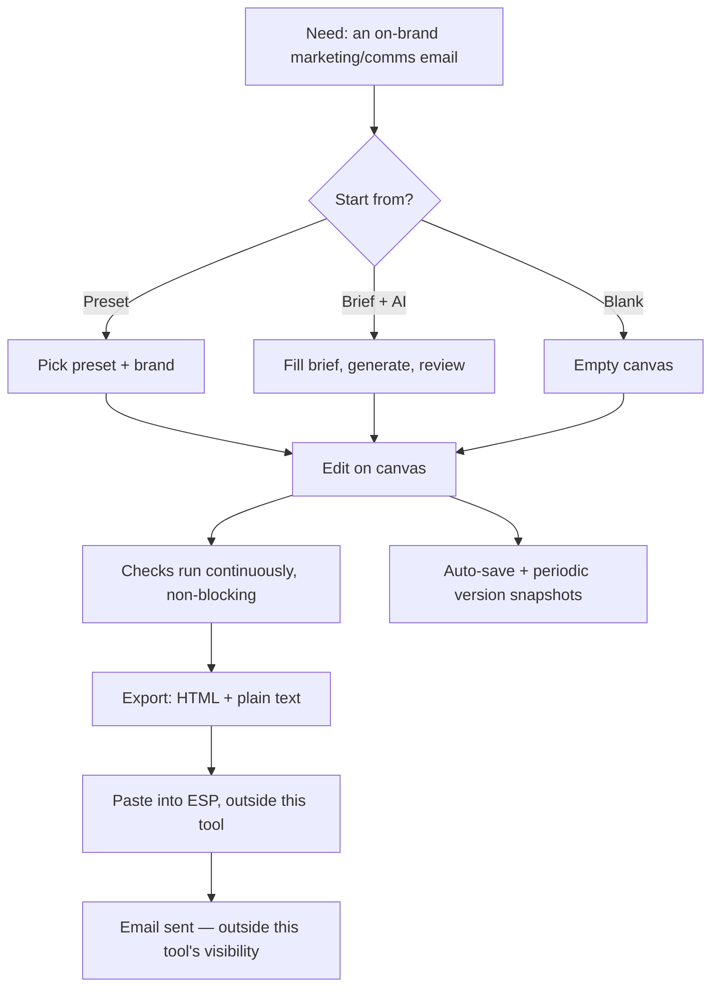
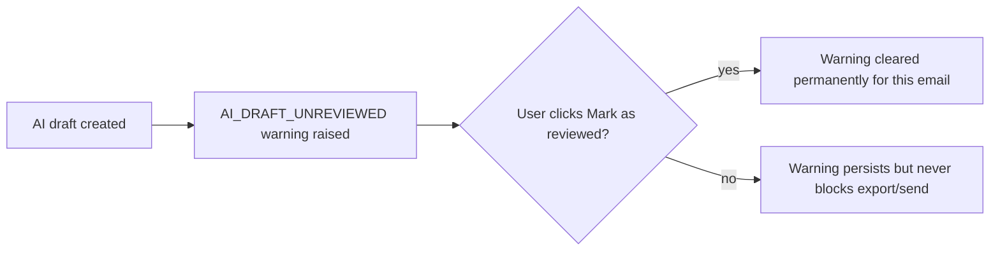
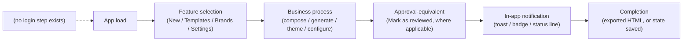
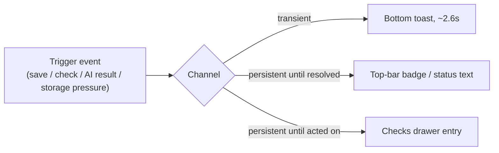
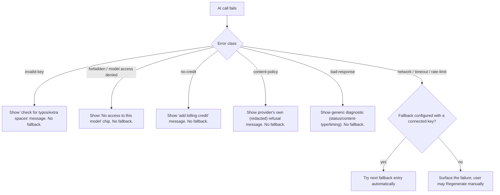
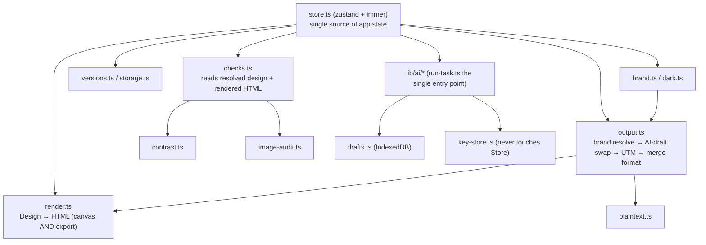

# Newsletter Builder — Business Requirements Document
## Part 4 of 4 — Sections 31–39

> Continues from `BRD-03.md`. See `docs/brd/README.md` for the table of contents and `docs/brd/VERIFICATION_NOTES.md` for the consolidated Inference / Not Found list.

---

## 31. Acceptance Criteria

Given/When/Then criteria below are **Inference**, phrased from the behavior and tests documented in `docs/PROGRESS.md` and confirmed in source — no formal acceptance-criteria document exists in the repository.

### 31.1 Brand kit (1A)
```
Given an email using brand.* color tokens
When the active brand is switched
Then every token-sourced color/font re-themes instantly
 And every manually-typed hex override on that email is unchanged
 And design.brandId is the only field that changed

Given a brand has no logo_url set
When the email is exported
Then the export contains no data: URI for that logo
 And the Checks/image-audit warns that the logo is not https, if a preview upload exists but no hosted URL does
```

### 31.2 Composite blocks (1B)
```
Given a Footer block exists and Email settings → Show footer is off
When the email is previewed or exported
Then the Footer block produces no HTML in the output
 And the canvas still shows it, dimmed, with a "Hidden on send" badge

Given a Hero block's layout is changed from "centered" to "cards-3"
When the change is applied
Then exactly 3 cards are present, padded with defaults or trimmed from the prior count
```

### 31.3 Presets (1C)
```
Given the user opens "New email" and picks the "Newsletter" preset
When the preset is applied
Then a fresh Design is created with new ids throughout
 And editing the new email never mutates the shared preset definition
 And the Checks drawer immediately shows IMAGE_PLACEHOLDER and LINK_PLACEHOLDER_DOMAIN warnings
```

### 31.4 Merge tags / UTM / plain text (2A)
```
Given UTM tagging is enabled with utm_medium="email"
When the email is exported
Then every qualifying link gains UTM parameters
 And the unsubscribe link is never tagged but IS counted in the "skipped" total
 And a link with its own "Don't add tracking" opt-out is never tagged

Given Email settings → Merge tag format is "Mailchimp"
When the email is exported
Then {{first_name}} becomes *|FNAME|* in the output
 And the stored design content still reads {{first_name}} unchanged
```

### 31.5 Saved blocks / auto-save / version history (2B)
```
Given a new, never-before-saved email is being edited for the first time
When 2 seconds pass after the first edit
Then a new SavedTemplate record is created, flagged autoSaved: true

Given a version is restored from History
When the restore completes
Then the design present immediately before the restore has itself been snapshotted
 And the user can immediately restore forward again to undo the restore
```

### 31.6 Image library (2C-1)
```
Given a user attempts "Upload from device" on an Image block
When the file dialog resolves
Then the action is refused with the message
  "Upload needs image hosting. Paste a public https image URL instead."
 And no data: URI is written into the block

Given an image URL has never been checked this session
When the Checks drawer is viewed
Then that image is never reported as IMAGE_BROKEN
 And only becomes reportable after "Check images load" is pressed and the probe fails
```

### 31.7 Checks engine (3A)
```
Given an email has 1 error and 2 warnings outstanding
When the user opens the Export dialog
Then Copy and Download remain enabled
 And the dialog shows "1 error, 2 warnings" with an "Open checks →" link

Given a Checks issue has been Ignored for a specific email
When the browser is reloaded and that same email is reopened
Then the issue remains ignored (hidden from the active list, visible under "Ignored (n)")
```

### 31.8 Dark mode (3B)
```
Given Email settings → Dark mode support is off
When the email is exported
Then the output is byte-identical to the same email exported before dark mode existed
 (no meta tags, no dm- class names, no extra <style> block)

Given a brand has no dark palette configured
When dark mode is on and the email is previewed in Dark
Then a derived palette is used (near-black page/panel, link lightened to clear 4.5:1, etc.)
 And no field renders as an unreadable or invisible color
```

### 31.9 AI image generation (5A)
```
Given no API key is configured
When the user opens the AI image panel
Then it opens directly into the Settings view, not the chat composer

Given a generation request fails with a 503 status
When the error is classified
Then the user sees a warning that the image "may well have been made and billed"
 And no automatic retry is attempted
```

### 31.10 AI brief generation (6A)
```
Given a brief with topic="Diwali sale" and no CTA label supplied
When the draft is generated
Then every cta_label-kind slot in the schema is AI-fillable
Given the same brief WITH a CTA label supplied
Then those same slots are removed from the AI schema entirely
 And the user's own label/URL are written onto the design directly

Given the AI response contains a slot value exceeding its character budget
When brief-validate.ts checks it
Then the entire response is rejected (not just that one field)
 And "Regenerate" is offered, with nothing written to any design

Given an email was created from a brief
When it is opened
Then the Checks drawer shows AI_DRAFT_UNREVIEWED
 until "Mark as reviewed" is clicked
```

### 31.11 Per-task AI model routing (6B)
```
Given a task's current model has no configured key
When the user's prior generation on that task fails with a timeout
Then the next fallback entry with a configured, connected key is tried automatically
Given the same failure is instead "invalid key" or "content policy"
Then no fallback is tried — the failure is surfaced immediately

Given a per-generation Quality selector is set to "Draft"
When the task's configured default quality is "High"
Then the generation uses "Draft" — the explicit per-call choice always wins
```

### 31.12 Settings hub / data governance (7A)
```
Given the "Clear all local data" danger-zone action
When the confirmation text field does not contain exactly "DELETE"
Then the action button remains disabled

Given a backup file is selected for import
When it is shape-validated
Then a summary of record counts is shown
 and nothing is overwritten until the user explicitly confirms
```

---

## 32. User Stories

All stories have a single actor — the Editor role (§5) — since no other role exists. Each includes acceptance criteria referencing §31 where applicable.

1. **As an** editor, **I want** to switch which brand an email uses **so that** I can re-theme a campaign for a different sub-brand without rebuilding it. *(AC: §31.1)*
2. **As an** editor, **I want** to start from a ready-made preset **so that** I don't begin every email from a blank canvas. *(AC: §31.3)*
3. **As an** editor, **I want** the app to warn me about placeholder art and copy left in a preset **so that** I never accidentally send unfinished content. *(AC: §31.3, §31.7)*
4. **As an** editor, **I want** my work auto-saved as I go **so that** closing the tab by accident never loses anything. *(AC: §31.5)*
5. **As an** editor, **I want** a version history I can preview and restore **so that** I can recover from a bad edit without fear of losing my current state. *(AC: §31.5)*
6. **As an** editor, **I want** to save a block or row I built **so that** I can reuse it (e.g., a CTA band) in future emails without rebuilding it. *(AC: implicit in 2B feature description, §9.5)*
7. **As an** editor, **I want** a centralized, vetted image library **so that** I stop hunting for the same hero image URL across emails. *(AC: §31.6)*
8. **As an** editor, **I want** to be warned — but never blocked — about size, broken links, poor contrast, and missing alt text **so that** I can fix real problems before a send without being stopped from exporting a work-in-progress. *(AC: §31.7)*
9. **As an** editor, **I want** my export to look correct in dark-mode-aware inboxes **so that** I don't have to maintain two separate versions of the same email. *(AC: §31.8)*
10. **As an** editor, **I want** to generate a hero or article image from a text prompt **so that** I don't need a separate design tool for on-brand art. *(AC: §31.9)*
11. **As an** editor, **I want** a clear warning when a generated image isn't actually hosted anywhere **so that** I never accidentally send an email with a broken image. *(AC: §31.9, §9.9)*
12. **As an** editor, **I want** to turn a short content brief into a full draft email **so that** I don't have to write the first draft from scratch. *(AC: §31.10)*
13. **As an** editor, **I want** to review and approve an AI-generated draft before it's final **so that** I catch factual errors or missing details before sending. *(AC: §31.10)*
14. **As an** editor, **I want** to choose a different AI model for text vs. image generation, with a fallback if one fails **so that** I'm not stuck when a provider has an outage or doesn't support a model I want. *(AC: §31.11)*
15. **As an** editor, **I want** one place to manage my profile, AI keys, brand defaults, and data **so that** I'm not hunting across the app for settings. *(AC: §9.12)*
16. **As an** editor, **I want** to back up and restore all my local data **so that** I can move to a new browser/machine without losing my brands, templates, and saved blocks. *(AC: §31.12)*
17. **As an** editor, **I want** a hard-to-trigger-by-accident "clear everything" action **so that** I can start fresh deliberately, without a stray click wiping my work. *(AC: §31.12)*
18. **As an** editor, **I want** my AI API key to never leave this browser except to the AI provider itself **so that** I'm not exposing a billable credential through an export or backup file. *(Implicit AC: §23, §13 BR-08)*

---

## 33. Business Glossary

| Term | Meaning |
|---|---|
| **Design** | The in-memory/persisted document representing one email: body settings + rows + columns + blocks |
| **Brand kit / Brand** | A named set of colors, fonts, logos, footer content, social links, and optional "voice" guidance used to theme emails |
| **Resolve at the boundary** | The architectural rule that color/font tokens (`"brand.primary"`) are converted to literal values exactly once, immediately before rendering/exporting, never inside the renderer itself |
| **Block** | One piece of content in the email — 9 atomic types (heading, text, image, button, divider, menu, social, video, html) and 4 composite types (header, hero, footer, articles) |
| **Composite block** | A block type (Header/Hero/Footer/Article list) built internally by reusing the real atomic renderers rather than duplicating HTML logic |
| **Preset** | One of 8 fixed starter structures offered in the "New email" dialog, brand-neutral and placeholder-filled on purpose |
| **Checks** | The non-blocking email-quality engine; "an issue" (or "Issue") is one finding with a severity, message, hint, and stable id |
| **Severity (error / warning / info)** | Checks' three-tier classification; none of the three ever disables Copy/Download/Export |
| **Ignore (a check)** | A per-email, per-issue dismissal that persists and survives reload until explicitly un-ignored |
| **Draft (AI image)** | A locally generated image's bytes, held in this browser's IndexedDB; the design only ever stores its id, never the bytes |
| **AI draft unreviewed** | The specific Checks warning that appears on any email created from a brief until "Mark as reviewed" is clicked |
| **Slot** | One AI-fillable text field, derived automatically by walking a preset's real block tree and classifying by block type (the "slot-derivation pattern," 6A) |
| **Task (AI)** | One of the product's two AI capabilities — `text.brief` or `image.generate` — each independently routed to a provider/model with its own fallback chain (6B) |
| **Fallback chain** | An ordered, user-configured list of alternate provider/model choices tried only on a network/timeout/rate-limit failure, never on a bad key or content-policy refusal |
| **Merge tag** | A `{{tag}}`-syntax personalization placeholder, stored canonically but reformatted per ESP (Mailchimp/HubSpot/custom) only at export |
| **UTM tagging** | Appending campaign-tracking query parameters to outbound links at export time only |
| **Auto-saved draft** (in the Templates modal) | A `SavedTemplate` record not yet given an explicit name by the user — distinct from a "named template" |
| **Version** / **Version history** | A full snapshot of a design taken manually, automatically (≤1/5min), or immediately before a restore/replace |
| **Saved block** | A frozen, reusable copy of a block or row, kept in a searchable per-browser library |
| **Image library** | The per-browser catalogue of vetted, name-and-alt-tagged, optionally brand-scoped image URLs |
| **Placeholder image/link** | Stock art (`picsum.photos` etc.) or a fake domain (`example.com` etc.) deliberately shipped in every preset, specifically to trip the `IMAGE_PLACEHOLDER`/`LINK_PLACEHOLDER_DOMAIN` checks until replaced |
| **Dark-mode additive guarantee** | With dark mode off, export output is byte-identical to a build of the app that never had dark mode at all |
| **Profile (display name)** | A local, unauthenticated, free-text label used only for `createdBy`/`updatedBy` attribution — not a login identity |
| **Settings hub** | The single two-level configuration surface (7A) covering Profile, AI, Brands, Email defaults, Checks, Data & storage, About |
| **Backup** | A one-file JSON export of brands, templates, saved blocks, images, and versions — deliberately excluding AI keys and drafts |
| **Clear all local data** | The typed-"DELETE"-gated action that wipes every category above, including AI keys and drafts |
| **BYOK (bring your own key)** | The architecture where the user supplies their own OpenAI API key, billed directly to them, with no backend proxy |

---

## 34. Frequently Asked Questions

**How does "approval" work for AI-generated content?**
There is no multi-person approval. The only gate is a single Checks warning, `AI_DRAFT_UNREVIEWED`, cleared by clicking "Mark as reviewed" — which the same person who generated the draft can click immediately, with or without actually changing anything. It is a reminder, not a control.

**Who can edit a record (brand, template, saved block)?**
Whoever has the browser open. There is no login and no per-record permission check; `canEditBrand()` always returns `true` today.

**What happens after an AI generation is "rejected" by validation?**
Nothing is written anywhere. The user sees the rejection reason and a "Regenerate" button. The brief fields the user typed are untouched, so regenerating doesn't require retyping anything.

**How are notifications sent?**
There is no external notification channel. "Notifications" are in-app only: toasts (auto-dismiss ~2.6s), the top-bar save-status text, and the Checks badge/drawer.

**Can two people work on the same email together?**
Not through this product. Each browser's local storage is independent; the only way to move work between people/machines is manual JSON export/import (whole designs, brand kits, saved blocks, images) or the full Data & storage backup/restore.

**What happens if my browser's storage fills up?**
Writes never fail silently. The app first tries to free space automatically by pruning the oldest version-history snapshots (10 at a time, across every email); if that's not enough, it reports "storage full" so the user can manually export/delete something. Brands, templates, images, and saved blocks are never auto-deleted.

**Does the app ever see or store my OpenAI API key insecurely?**
The key defaults to memory-only (gone when the tab closes). If you opt into "Remember on this device," it's written to `localStorage` — the UI explicitly tells you this is unencrypted. The key is deliberately kept out of the app's main state store and out of the backup export, both enforced structurally and verified by dedicated tests, so no export/backup/saved-block action can leak it.

**Will my export look right in dark mode?**
If "Dark mode support" is on for that email (default: on for new emails), the export carries additive dark-mode CSS that most major clients respect — except Gmail's own apps, which always apply their own automatic color inversion regardless of anything this app does; the in-app Preview explicitly says so.

**Can I send the email directly from this app?**
No. The app produces HTML and plain text; sending happens through whatever ESP the team already uses (SES, SendGrid, Mailchimp, HubSpot, etc.), entirely outside this tool.

**What if an AI-generated image never gets a real public URL?**
It will keep exporting as a visible placeholder image (and the Checks drawer will keep warning about it) until someone downloads the generated PNG, uploads it somewhere public, and pastes that https URL into the field — there is no image-hosting feature built in yet.

---

## 35. Business Process Diagrams

### 35.1 Overall business process


### 35.2 Department workflow
**Not Found in Codebase / Not Applicable** — a single department (marketing/communications) and a single role perform every step above; there is no cross-department handoff to diagram.

### 35.3 Approval workflow


### 35.4 User journey (consolidated — see §12 for the six full variants)


### 35.5 Notification flow


### 35.6 Decision tree — "why did my AI call fail, and what happens next?"


### 35.7 Role interaction
**Not Found in Codebase / Not Applicable** — one role.

### 35.8 State transition
See §14 for the three state machines that exist (saved-email lifecycle, AI-brief-review lifecycle, per-issue Checks lifecycle).

### 35.9 Navigation flow
See §11.1.

### 35.10 Module interaction


---

## 36. End-to-End Business Scenario

**Scenario chosen:** *"The MARCOM team sends a Diwali promotional email, drafted by AI, themed to the Vee Technologies brand, with an AI-generated hero image, checked for quality, and exported for their ESP."* This scenario deliberately exercises the two most business-significant workflows (6A and 5A) end-to-end, referencing the actual screens/modules/entities involved.

```
Business Need
  The team needs a promotional email about a Diwali sale, going out soon, and
  nobody has time to write a first draft from scratch or hunt for stock art.
  ↓
User Action (Screen: TopBar "New" → NewEmailModal → "Generate from brief" tab)
  The editor fills BriefForm: topic="Diwali sale on annual plans", audience=
  "existing customers", goal="promote", 3 key points, tone="bold", length=
  "medium", CTA left blank, language="English".
  ↓
Validation (BriefForm.tsx: briefError())
  Topic present; total characters under BRIEF_MAX_CHARS (4000); CTA URL
  field empty so its https-only rule doesn't apply.
  ↓
Decision Point (isTaskReady('text.brief'))
  The text.brief task already has a Connected OpenAI key from a prior
  session — no detour to Settings → AI is needed.
  ↓
Decision Point (hasTextConsent('openai'))
  First time for this provider → the data-use notice is shown: "Your brief
  and Vee Technologies's brand voice are sent to OpenAI to generate this
  draft. Nothing else — no API key, logo, footer or other saved content."
  The editor clicks "Agree and generate" (grantTextConsent('openai') fires).
  ↓
Processing (create-from-brief.ts + slots.ts + brief-prompt.ts + OpenAI
  Chat Completions API)
  goal="promote" auto-resolves to the "promotional" preset (preset-
  selection.ts). buildSlotSchema() walks that preset's real block tree and
  finds its AI-fillable fields (heading text, hero eyebrow/heading/subtext,
  button label, etc.) — none of them hero-card fields, because this preset's
  Hero layout isn't cards-2/cards-3. One strict-JSON-schema request is sent;
  the response is validated field-by-field by brief-validate.ts (binary
  accept/reject).
  ↓
Review (Screen: BriefReview)
  The editor sees 3 subject-line options, a preheader, and one suggested
  image prompt for the Hero's image slot. No bracket placeholders remain —
  the brief gave enough detail. The editor picks a subject line.
  ↓
Approval-equivalent action (button: "Create email")
  writeBriefDraftOntoDesign() writes every slot value onto a FRESH copy of
  the promotional preset's Design; design.body.title and .preheader are set;
  a BriefRecord {reviewed:false} is attached. startNewEmail() makes this the
  active document (Checks.ts: AI_DRAFT_UNREVIEWED now active).
  ↓
Processing (Screen: RightPanel → Hero block → "Generate with AI")
  The editor selects the Hero image field and opens the AI image panel,
  pastes in the AI-suggested prompt text (copied from BriefReview), picks
  aspect "16:9", style "Cinematic elegant", quality "high", and toggles
  "Brand colours" on. Send → one request to OpenAI's image endpoint
  (openai.ts) → response validated by magic bytes → stored as a DraftImage
  in IndexedDB with a fresh aiDraftId.
  ↓
Validation (AiImagePanel.tsx)
  Alt text is required before "Add to email" is enabled; the editor types a
  description. target.onUse() writes the Hero's imageSrc field's aiDraftId.
  ↓
Data Update (store.ts: refreshDrafts())
  The app's knownDrafts set now includes this id, so Checks correctly
  classifies it as AI_IMAGE_NOT_HOSTED (bytes present locally, no public
  URL yet) rather than AI_IMAGE_MISSING_DRAFT.
  ↓
Notification (Checks drawer, debounced 500ms)
  Two warnings now show: AI_DRAFT_UNREVIEWED and AI_IMAGE_NOT_HOSTED. Both
  are warnings, not errors — export remains fully enabled throughout.
  ↓
Remediation
  The editor reviews the generated copy against the brief, is satisfied,
  and clicks "Mark as reviewed" (clears AI_DRAFT_UNREVIEWED). They download
  the generated PNG, upload it to the team's existing image CDN (outside
  this app), and paste the resulting https URL into the Hero image field —
  which clears aiDraftId and resolves AI_IMAGE_NOT_HOSTED automatically on
  the next Checks run.
  ↓
Completion (Screen: ExportHtmlModal)
  Checks now shows 0 errors, 0 warnings (or only acceptable info-level
  notes). The editor opens Export, confirms the size (well under 90KB) and
  the UTM summary (UTM is off for this send, so 0/0), downloads the .html
  file, and pastes it into their ESP's campaign editor — sending itself
  happens entirely outside Newsletter Builder.
```

**Entities touched:** `Brand` (Vee Technologies, read-only in this scenario), `BriefFields`/`BriefDraft`/`BriefRecord`, `Design`/`SavedTemplate` (the new email, auto-saved along the way), `DraftImage` (IndexedDB), `Issue` (two warnings raised and resolved). **Screens touched:** NewEmailModal, BriefForm, BriefReview, RightPanel, AiImagePanel, ChecksPanel, ExportHtmlModal. **Modules touched:** 1A (brand), 1C (preset), 2A (export boundary), 3A (Checks), 5A (AI image), 6A (brief generation). **APIs touched:** OpenAI Chat Completions (text) and Images (image) endpoints, both called directly from the browser.

---

## 37. Traceability Matrix

| Req ID | Business Objective | Module | Feature | Screen | Workflow | Business Rule(s) | Validation | API | DB Entity | User Role | Status |
|---|---|---|---|---|---|---|---|---|---|---|---|
| RTM-01 | Brand consistency | Brand kit | 1A | BrandsModal | §12.4 | BR-01, BR-02, BR-03, BR-04 | Name required | — | Brand | Editor | Shipped |
| RTM-02 | Faster authoring | Canvas / Composite blocks | 1B | Canvas, RightPanel | §7.1 | §9.2 rules | Alt text required | — | Row/Column/Block | Editor | Shipped |
| RTM-03 | Faster time-to-draft | Presets | 1C | NewEmailModal | §7.1 | BR-24, BR-25 | — | — | Design (via preset.build) | Editor | Shipped |
| RTM-04 | ESP-ready export | Export / merge tags / UTM | 2A | Modals (Export) | §7.1 | BR-19, BR-20, BR-21 | CTA/URL rules (brief only) | — | BodySettings.mergeFormat/utm | Editor | Shipped |
| RTM-05 | No lost work | Auto-save / versions / saved blocks | 2B | TopBar, HistoryModal, Modals (Templates), LeftPanel (Saved tab) | §12.5, §14.1 | BR-11, BR-12, BR-13, BR-25 | Name required (rename) | — | SavedTemplate, VersionRecord, SavedBlock | Editor | Shipped |
| RTM-06 | Fewer broken images | Image library | 2C-1 | ImageLibrary, ImagePickerModal | §12.3 (partial) | BR-07, BR-17 | URL scheme/shape validation | — | LibraryImage | Editor | Shipped |
| RTM-07 | Fewer broken sends | Checks (quality engine) | 3A | ChecksPanel | §7.3, §14.3 | BR-05, BR-07 | Size/contrast/link/subject rules | — | Issue (in-memory) + ignored-issues store | Editor | Shipped |
| RTM-08 | Correct dark-mode rendering | Dark mode | 3B | TopBar (scheme toggle), PreviewModal | §7.1 (export branch) | BR-22, BR-23 | — | — | Brand.darkTokens | Editor | Shipped |
| RTM-09 | On-brand imagery without a separate tool | AI image generation | 5A | AiImagePanel | §12.3 | BR-06, BR-08 | Magic-byte validation; alt text required | OpenAI Images API | DraftImage (IndexedDB) | Editor | Shipped (no hosting → §29 gap) |
| RTM-10 | Faster first drafts | AI brief generation | 6A | NewEmailModal (Brief tab), BriefForm, BriefReview | §7.2, §12.2, §14.2, §36 | BR-26, BR-27, BR-28 | Topic required; 4000-char cap; CTA https | OpenAI Chat Completions API | BriefRecord | Editor | Shipped |
| RTM-11 | Resilient, controllable AI usage | Per-task model routing | 6B | AiSection | §13 | BR-29, BR-30 | — | OpenAI (GET /v1/models, chat, images) | TaskRoutes | Editor | Shipped |
| RTM-12 | Consolidated configuration | Settings hub / Profile / Data governance | 7A | SettingsHub + 7 sections | §12.6, §9.12 | BR-14, BR-15, BR-16 | Display name ≤40 chars; typed "DELETE" gate | — | CurrentUser, EmailDefaults, BackupData | Editor | Shipped |

---

## 38. Production Readiness (Business Perspective)

| Dimension | Assessment |
|---|---|
| **Business completeness** | High for its stated scope (design → check → export). Zero for anything it explicitly never claimed to do (sending, hosting, multi-user). |
| **Workflow completeness** | The AI-brief and AI-image workflows are fully wired end-to-end, including a human-review step, but both terminate in a **manual** handoff (review click; manual image rehosting) rather than a fully closed loop. |
| **User experience** | Consistently designed around "never block, always explain" (Checks, storage-full messaging, AI error redaction) — a strong, deliberate UX principle applied uniformly across very different features. |
| **Operational readiness** | Weak outside the browser: no backup is automatic, no monitoring/telemetry exists, and the "production" environment is literally every individual user's own browser profile with no central ops visibility. |
| **Maintainability** | Strong: strict TypeScript config, 39 test files, documented architectural rules (`docs/PROGRESS.md`) with explicit rationale for nearly every non-obvious decision. **Gap:** no dedicated lint script. |
| **Extensibility** | Strong in the areas the team clearly anticipated extending (AI tasks, slot derivation, brand permission seams); weaker where no seam was built (image hosting, a second AI provider, roles). |
| **Documentation quality** | Unusually high for an internal tool — `docs/PROGRESS.md` documents business rationale, known gaps, and test coverage per feature, which is what made this BRD possible to produce with very few "Not Found" gaps. |
| **Business risks** | Concentrated in exactly two places: (1) total reliance on one browser's local storage with no automatic off-machine backup, and (2) uncapped, unmonitored direct AI billing exposure per user. Both are named explicitly in this document (§28) rather than hidden. |
| **Training requirements** | **Inference:** Low for the core editing flow (visual, drag-and-drop); Medium for the AI features (requires understanding BYOK, consent, and the review step is advisory not enforced); Low for Settings (one hub, clearly labeled). |
| **Overall score** | **68 / 100** (Inference — a qualitative judgment, not a measured score). The product is a complete, well-engineered, honestly-documented tool for exactly the single-user, single-browser scope it set out to cover — the score is held back entirely by the absence of anything beyond that scope (no sync, no hosting, no sending, no cost controls, no monitoring), all of which the product itself is explicit and unapologetic about not providing yet. |

**Strengths:** rigorous, test-verified business-rule discipline (resolve-at-the-boundary, never-block-only-warn, no-double-bill-retry, never-accuse-before-looking); genuinely defense-in-depth AI-key security engineering for a client-only app; an unusually honest internal documentation trail that distinguishes shipped behavior from known gaps feature-by-feature.

**Weaknesses:** no automatic backup/sync mechanism for a product whose entire data model is local-only; no AI cost visibility or caps; the human-review gate on AI content is advisory, not enforced; no accessibility/localization investment in the builder UI itself (only in its output); no CI evidence found in the reviewed scope.

**Recommendations:** (1) prioritize image hosting and/or a Supabase-backed persistence layer (both already named in the README's own roadmap) to close the two largest business-continuity risks at once; (2) add a lightweight AI-usage cost/counter display, even client-side-estimated, given zero visibility exists today; (3) consider whether the unreviewed-AI-content warning should be strengthened (e.g., a one-click "I reviewed this" requirement before Export, rather than purely informational) given it currently carries no teeth.

---

## 39. Final Business Knowledge Validation

### "If You Read This Entire BRD"

You now understand:

✔ **Business objectives** — a single internal marketing/communications team producing on-brand, inbox-safe HTML emails, increasingly assisted by AI, entirely without a backend or a login.

✔ **Stakeholders** — effectively one functional role (the Editor), with deliberate, unbuilt seams for a future multi-user system, and OpenAI as the only external party the product talks to.

✔ **User roles** — exactly one, unrestricted, with no RBAC anywhere; "Profile" is a local label, not an account.

✔ **Business processes** — compose → (optionally AI-draft, with mandatory-in-spirit-but-not-enforced human review) → check (always advisory) → export → hand off manually to an ESP.

✔ **Functional requirements** — 12 shipped features (1A through the 6B amendment) spanning brand theming, composite content blocks, presets, merge/UTM/plain-text export, auto-save/versioning/reuse, an image library, a non-blocking quality engine, dark mode, two AI pipelines with bring-your-own-key security, per-task model routing with fallback, and a consolidated Settings/data-governance hub.

✔ **Business rules** — 30 named rules (§13), the most load-bearing being "resolve at the boundary," "never block, only warn," "no retry that could double-bill," "never accuse before looking," and "API keys never enter serializable state" — each enforced by dedicated tests, not just convention.

✔ **Validation rules** — exhaustively cataloged in §17, from image-URL scheme checks to WCAG contrast math to the AI brief's strict-JSON-schema acceptance gate.

✔ **User journeys** — six complete, screen-by-screen paths (§12) covering first use, AI-brief drafting, AI-image generation, brand management, mistake recovery, and data portability.

✔ **Workflow states** — the saved-email lifecycle, the AI-brief review lifecycle, and the per-issue Checks lifecycle (§14) — notably, the absence of any multi-party approval state machine, which this document states plainly rather than inventing one.

✔ **Navigation** — a single-screen SPA with no router, no URLs, and no role-based menu variation; every "screen" is a modal, overlay, or panel-swap (§10, §11).

✔ **Modules** — 15 modules (§8), each with a clear single business purpose and no overlapping ownership.

✔ **Features** — full Given/When/Then-ready documentation for all 12 (§9, §31).

✔ **Reports** — effectively none in the BI sense; only live, in-context status readouts (§19).

✔ **Dashboards** — effectively none; a single Checks-severity badge is the closest analogue (§20).

✔ **Notifications** — entirely in-app and ephemeral; no email/SMS/push channel exists (§18).

✔ **Integrations** — exactly one real one (OpenAI, direct from the browser, BYO key), and one conspicuously absent-by-design one (no ESP/sending integration) (§21–22).

✔ **Security** — no authentication exists at all; the one genuinely sensitive artifact (the AI API key) is handled with real, test-verified defense-in-depth despite the absence of any backend to enforce it server-side (§23).

✔ **Data requirements** — a clean, well-normalized local data model (§15–16) with explicit, tested migration rules for every schema change in the product's history, and no server-side counterpart of any kind.

✔ **Traceability** — every shipped feature mapped end-to-end from business objective through screen, rule, validation, API, and data entity to its status (§37).

✔ **Risks** — concentrated and named plainly: no automatic off-device backup, uncapped direct AI billing exposure, and an advisory-only human-review gate on AI content (§28).

✔ **Future roadmap** — image hosting and a Supabase-backed persistence layer are the two highest-leverage next steps, both already named by the product's own maintainers, not invented for this document (§30).

You can now confidently participate in product discussions, requirement gathering, QA validation, stakeholder meetings, backlog refinement, feature-enhancement planning, and future product development for Newsletter Builder **without reverse-engineering the code yourself** — and, just as importantly, without mistaking any of its deliberate current-state boundaries (no login, no sending, no hosting, no cross-device sync) for defects rather than documented, intentional scope.

