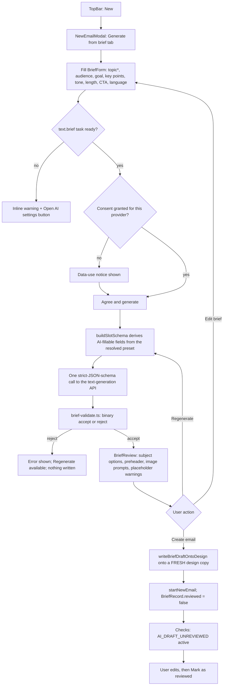
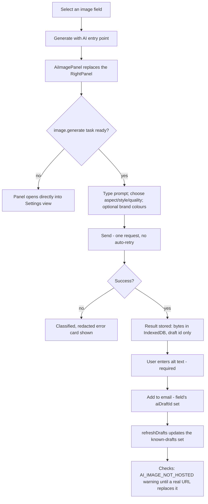
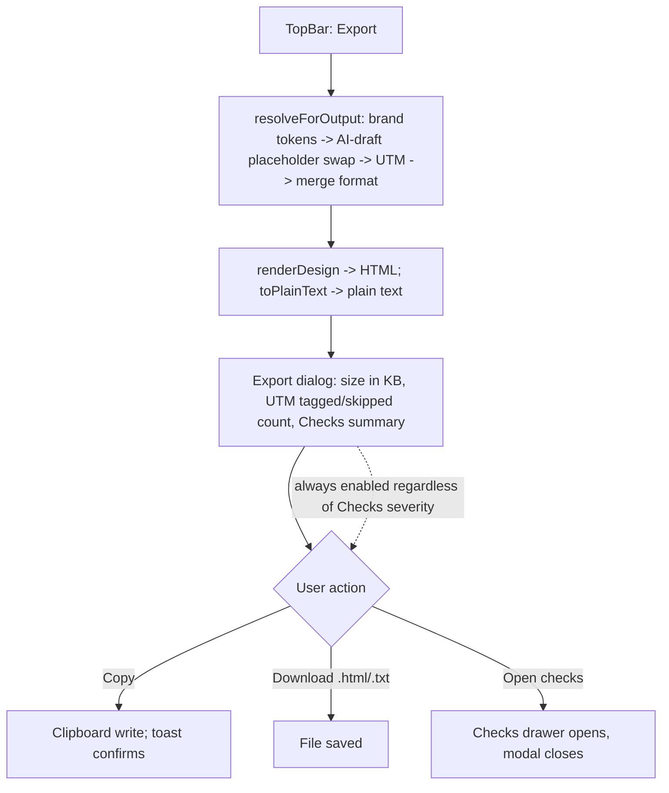
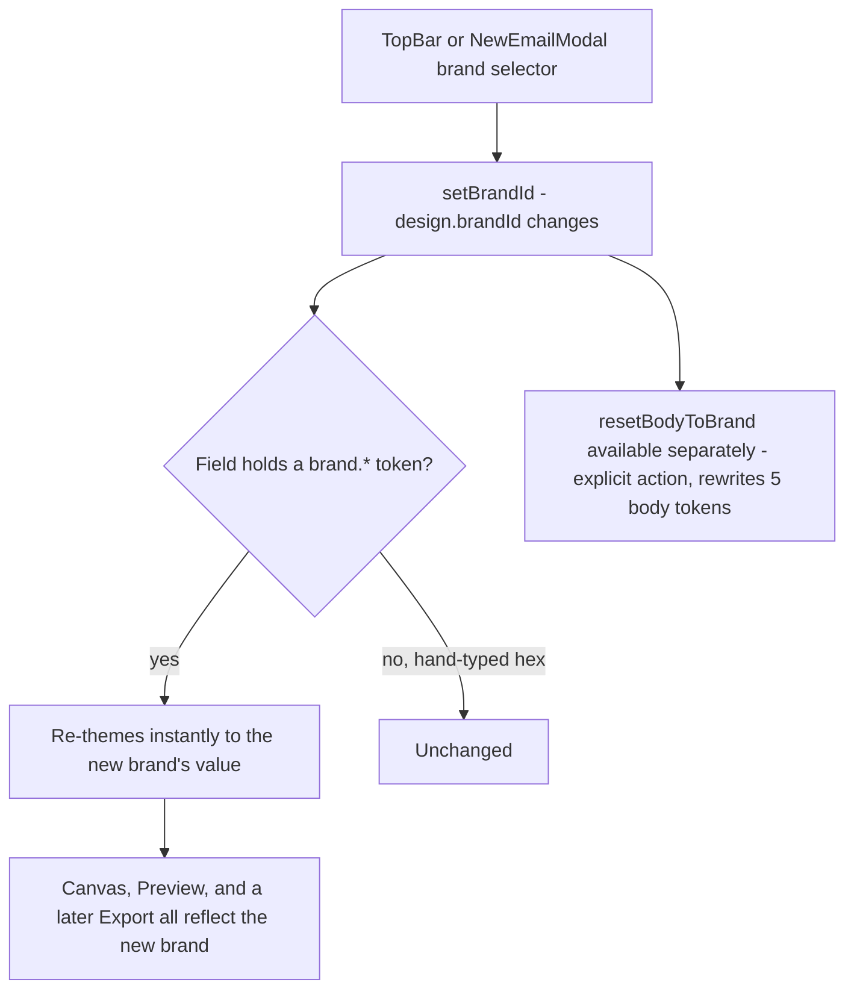
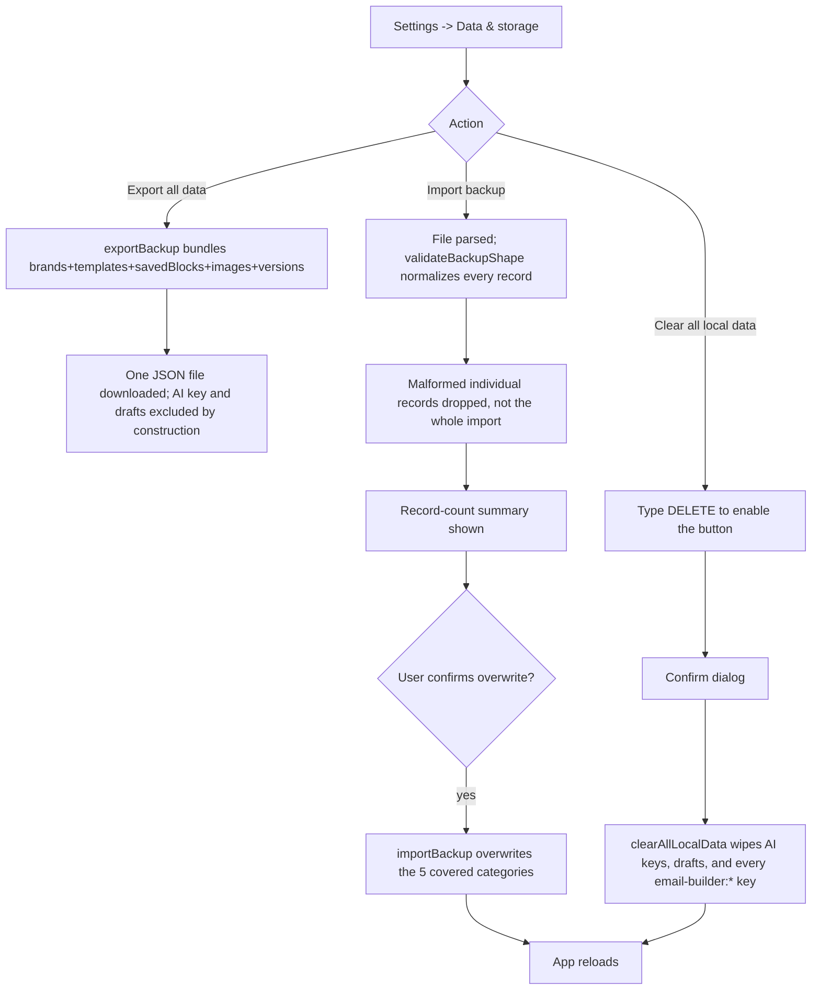

# Newsletter Builder — Product Requirements Document
## Part 3 of 4 — Sections 6–10: User Flows, Screens, Functional Requirements, NFRs, Data

> Continues from `PRD-02-feature-specs.md`. `PR-xxx` ids introduced in §8 are used again, unchanged, in Part 4 §15 (traceability matrix).

---

## 6. User Flows

### 6.1 New email from a preset
```mermaid
flowchart TD
    A[TopBar: New] --> B[NewEmailModal opens, Presets tab]
    B --> C[Pick a brand in the dialog header]
    C --> D[Thumbnails re-render themed with that brand]
    D --> E{Pick Blank or a preset card}
    E -->|dirty design exists| F[Confirm: "A change from the last couple of seconds may not be saved yet"]
    F -->|confirmed| G
    E -->|not dirty| G[snapshot pre-replace; preset.build(brand) or emptyDesign()]
    G --> H[applyEmailDefaults overlays org-wide defaults]
    H --> I[startNewEmail - currentEmailId = null]
    I --> J[Canvas shows the new design; modal closes]
    J --> K[First edit triggers auto-save, minting a new SavedTemplate]
```

### 6.2 New email from a brief (AI)


### 6.3 AI image generation and use


### 6.4 Export


### 6.5 Brand switch


### 6.6 Import / backup


---

## 7. Screen and Panel Inventory

No URL router exists anywhere in the app (confirmed: `App.tsx` uses a `ModalName` union and component state, no `react-router`/history API). Every "screen" below is a modal, an overlay, or a panel swap.

| Screen/Panel | Purpose | Entry point(s) | Key controls | States |
|---|---|---|---|---|
| TopBar | Title, brand switch, undo/redo, device/scheme toggle, save status, modal launchers | Always visible | New, Templates, History, Import/Download JSON, Export, Checks badge, Preview | Save status (idle/saving/saved/error); undo/redo enabled/disabled |
| LeftPanel | Add content; manage saved blocks/images; Settings/Profile entry | Always visible | 4 tabs (Content/Rows/Saved/Images); Settings gear; Profile row | Tab selection; Settings-hub-open (replaces tab content); narrow-viewport full-screen sheet |
| Canvas | WYSIWYG editing surface = the real export renderer | Always visible | Click/drag select, drag-reorder, per-block duplicate/delete | Selected block/row highlighted; hidden Footer dimmed with "Hidden on send" badge |
| RightPanel | Property editor for the current selection, or email-wide settings | Always visible (replaced by AiImagePanel during image generation) | Per-type editors; Save as block/Duplicate/Delete; Reset to brand | Empty-selection (body settings) vs. block vs. row |
| NewEmailModal | Start a new email | TopBar "New" | Brand selector; Presets/Brief tabs | Presets grid vs. Brief-form vs. Brief-review |
| BriefForm | Collect AI brief inputs | Inside NewEmailModal | Topic*, audience, goal, key points, tone, length, CTA, language, preset, source text | Not-ready (no key) / consent-pending / ready-to-generate / busy |
| BriefReview | Human review of the AI draft | After a successful generation | Subject picks, editable subject, Create/Regenerate/Edit-brief | Busy (regenerating) vs. idle |
| BrandsModal | Brand-kit CRUD | TopBar palette icon; Settings → Brands | New/Import; per-brand Export/Duplicate/Edit/Archive/Restore | List view vs. edit-form view |
| TemplatesModal | Browse/open/rename/delete saved emails | TopBar "Templates" | Rename this email; Save as a copy; Open; Delete | Named templates vs. "Drafts (auto-saved)" grouping |
| HistoryModal | Version browse/restore | TopBar "History" | Save version; Preview; Restore | List view vs. read-only version-preview view |
| ExportHtmlModal | Produce the deliverable | TopBar "Export" | Copy, Download, Open-checks | HTML tab vs. Plain-text tab |
| PreviewModal | See the real exported HTML | TopBar "Preview" | Desktop/Mobile; Light/Dark | Dark toggle disabled when the email's dark mode is off |
| ChecksPanel (drawer) | Review/act on quality issues | Checks badge; "Open checks" | Go to block; Ignore/Un-ignore; Check images load | Empty (all clear) vs. grouped-by-severity list; "Ignored (n)" collapsed/expanded |
| AiImagePanel | Generate/use an AI image | Any image field's AI entry point | Prompt, aspect, style, quality, brand-colours; Send/Cancel/Regenerate/Edit-prompt/Download | Chat view vs. Settings view; composer enabled/disabled by readiness |
| AI settings view (shared) | Manage provider key(s) | AiImagePanel gear; Settings → AI | Add/Replace key, Test and save, Test connection, Remove key | Per-provider: Not configured / Configured / Connected |
| ImageLibrary / ImagePickerModal | Manage/choose vetted image URLs | LeftPanel "Images" tab; any image field's picker | Add (URL paste + probe), Export, Import, Copy URL, Delete | Browse mode vs. pick mode; per-image ok/broken/unknown |
| SaveBlockDialog | Save a block/row to the library | "Save as block" | Name*, Category | — |
| SettingsHub | Single configuration home | LeftPanel gear/Profile | 7 section rows | Section list vs. section detail |
| Settings → Profile | Local display name | SettingsHub | Display name, Save | Valid/invalid (empty) |
| Settings → AI | Keys + per-task routing | SettingsHub | Per-task provider/model/option/fallback pickers, Test connection, Reset to defaults | Status chip per task; denial chip |
| Settings → Brands | Default brand + management entry | SettingsHub | Default-brand dropdown, "Manage brands" | — |
| Settings → Email defaults | Org-wide new-email defaults | SettingsHub | Merge format(+custom), UTM source/medium, Dark-mode toggle | — |
| Settings → Checks | Bulk-reset dismissed warnings | SettingsHub | Reset for this email (n); Reset for every email | — |
| Settings → Data & storage | Backup/restore/clear | SettingsHub | Export all data; Import backup; typed-`DELETE` danger zone | Pending-import summary vs. idle; danger zone collapsed/expanded |
| Settings → About | Version + shortcuts reference | SettingsHub | Link to README | — |
| ConfirmDialog | Reusable destructive-action confirm | Any destructive action | Confirm/Cancel | Danger-styled vs. neutral |

---

## 8. Functional Requirements (PR ids)

Priority is **Inference** (MoSCoW) — no prioritization document exists; a requirement is Must if removing it would break a BR-cited guarantee or a core authoring workflow, Should if it is a documented, deliberately-engineered behavior that is not load-bearing for correctness, Could if it is a UX nicety, Won't if it is explicitly out of scope today (listed for completeness, not as a demand).

| PR id | Requirement | Feature | Priority | BR link |
|---|---|---|---|---|
| PR-001 | The system shall render every block through one shared function used identically by the canvas and the export | F-001 | Must | no BRD link |
| PR-002 | The system shall provide undo/redo with at least 100 steps and coalesce rapid same-field edits into one step | F-001 | Should | no BRD link |
| PR-003 | The system shall support rows with 1–4 columns and arbitrary ratio layouts | F-002 | Must | no BRD link |
| PR-004 | A row layout change shall never delete content; overflow blocks merge into the last kept column | F-002 | Must | no BRD link |
| PR-005 | The system shall provide 9 atomic block types: heading, text, image, button, divider, menu, social, video, HTML | F-003 | Must | no BRD link |
| PR-006 | Every href/src rendered to HTML shall pass through scheme sanitization (`safeUrl`) | F-003 | Must | no BRD link |
| PR-007 | The system shall provide 4 composite block types (Header, Hero, Footer, Article list) built from the atomic renderers, not duplicated HTML | F-004 | Must | no BRD link |
| PR-008 | Composite-block images shall require alt text in the editor | F-004 | Should | no BRD link |
| PR-009 | Hiding the Footer (Show footer off) shall remove it from preview/export while keeping it visible-but-dimmed on canvas | F-004 | Should | no BRD link |
| PR-010 | The system shall offer 8 preset structures plus Blank, each re-themeable per brand | F-005 | Must | BR-24 |
| PR-011 | Applying a preset shall mint fresh ids so the applied copy can never alias the stored preset | F-005 | Must | BR-25 |
| PR-012 | Preset art/copy shall ship as placeholder on purpose, flaggable by Checks until replaced | F-005 | Should | no BRD link |
| PR-013 | The system shall support named, CRUD-able brand kits (colors, fonts, logos, footer, social, voice) | F-006 | Must | no BRD link |
| PR-014 | Switching the active brand shall change only `design.brandId`; content and manual overrides shall be untouched | F-006 | Must | BR-02 |
| PR-015 | A design referencing an archived/deleted brand shall silently resolve to the default brand | F-006 | Must | BR-03 |
| PR-016 | Export shall use only the hosted logo URL, never an uploaded preview logo | F-006 | Must | BR-04 |
| PR-017 | The system shall support a per-brand dark palette, derivable automatically when unset | F-007 | Should | no BRD link |
| PR-018 | With dark mode off, export shall be byte-identical to a build with no dark-mode feature at all | F-007 | Must | BR-22 |
| PR-019 | A color sourced from a brand token shall move between light/dark passes; a hand-typed hex shall not | F-007 | Must | BR-23 |
| PR-020 | The system shall store merge tags canonically as `{{tag}}` and reformat only at export | F-008 | Must | BR-21 |
| PR-021 | The system shall support at least 4 merge-tag output formats (curly, Mailchimp, HubSpot, custom) | F-008 | Should | no BRD link |
| PR-022 | UTM tagging shall apply only at export, never editing stored content | F-009 | Must | no BRD link |
| PR-023 | UTM tagging shall never overwrite an existing `utm_*` parameter | F-009 | Must | BR-19 |
| PR-024 | The unsubscribe/view-in-browser links shall never be UTM-tagged, but shall be counted in the skipped total | F-009 | Should | BR-20 |
| PR-025 | The system shall generate a plain-text alternative from the same resolved design as the HTML | F-010 | Must | no BRD link |
| PR-026 | Plain-text output shall never split a URL across the wrap width | F-010 | Should | no BRD link |
| PR-027 | The Export dialog shall report export size and UTM tagged/skipped counts | F-011 | Should | no BRD link |
| PR-028 | Export/Copy/Download shall remain enabled regardless of outstanding Checks severity | F-011 | Must | BR-05 |
| PR-029 | Preview shall render the literal string that export would produce, with no second renderer | F-011 | Must | no BRD link |
| PR-030 | The system shall evaluate size, link, subject/preheader, contrast, readability, content, and image rules on every design/brand change | F-012 | Must | no BRD link |
| PR-031 | An image or AI draft shall never be reported broken/missing until it has actually been checked | F-012 | Must | BR-07 |
| PR-032 | A dismissed ("Ignored") issue shall persist per email and survive reload until explicitly un-ignored | F-012 | Should | no BRD link |
| PR-033 | The system shall support saving any block or row to a named, categorized, reusable library | F-013 | Must | no BRD link |
| PR-034 | Inserting a saved block shall always mint fresh ids, never aliasing the library original | F-013 | Must | BR-25 |
| PR-035 | The system shall auto-save every design change within a few seconds, creating a record on first edit | F-014 | Must | BR-11 |
| PR-036 | A save failure shall always be surfaced to the user, never silent | F-014 | Must | no BRD link |
| PR-037 | On storage-quota pressure, the system shall prune old version history automatically before reporting failure | F-014 | Should | BR-13 |
| PR-038 | The system shall keep up to 20 version snapshots per email, newest-prioritized | F-015 | Must | BR-13 |
| PR-039 | Restoring a version shall snapshot the current state first, making the restore itself reversible | F-015 | Must | BR-12 |
| PR-040 | The system shall never snapshot a design identical to the latest stored version | F-015 | Should | BR-12 |
| PR-041 | The system shall maintain a reusable library of vetted https image URLs with name/alt/tags/brand scope | F-016 | Must | no BRD link |
| PR-042 | File upload for content images shall be categorically refused, never falling back to an embedded data URI | F-016 | Must | BR-17 |
| PR-043 | An image's broken/ok status shall only be set after an explicit load probe | F-016 | Should | BR-07 |
| PR-044 | The system shall generate an image from a text prompt via a user-supplied API key, with no backend proxy | F-017 | Must | no BRD link |
| PR-045 | A generated image's bytes shall be stored only in this browser (IndexedDB); the design shall carry only an id | F-017 | Must | no BRD link |
| PR-046 | An AI generation request shall never be automatically retried | F-017 | Must | BR-06 |
| PR-047 | The system shall generate a structured email draft from a brief, targeting an existing preset's real fields | F-018 | Must | no BRD link |
| PR-048 | The set of AI-fillable fields shall be derived from the preset's actual block tree, not hand-maintained per preset | F-018 | Must | BR-26 |
| PR-049 | A user-supplied CTA shall remove the corresponding field(s) from the AI request entirely | F-018 | Should | BR-27 |
| PR-050 | An AI brief response shall be validated as a whole; a shape/limit violation shall reject the entire response | F-018 | Must | BR-28 |
| PR-051 | A brief-generated email shall carry a human-clearable "unreviewed" indicator until explicitly marked reviewed | F-018 | Should | no BRD link |
| PR-052 | The system shall allow independent model/provider selection per AI capability (text vs. image) | F-019 | Should | no BRD link |
| PR-053 | A per-generation quality/temperature choice shall override the task's configured default for that one call only | F-019 | Should | no BRD link |
| PR-054 | The system shall support an ordered, per-task fallback list of alternate models/providers | F-020 | Could | BR-29 |
| PR-055 | A fallback shall be attempted only for network/timeout/rate-limit failures, never for bad-key/content-policy/malformed-response failures | F-020 | Must | BR-29 |
| PR-056 | The system shall store at most one API key per provider, defaulting to in-memory-only | F-021 | Must | BR-08 |
| PR-057 | A replacement key shall only be persisted after passing a connection test | F-021 | Must | BR-30 |
| PR-058 | Provider-echoed error text shall be redacted of key-shaped substrings before display | F-021 | Must | BR-08 |
| PR-059 | The system shall provide one consolidated settings area covering profile, AI, brands, email defaults, checks, and data | F-022 | Should | no BRD link |
| PR-060 | A local display name shall be used only for local attribution, never as an authentication credential | F-022 | Must | BR-10 |
| PR-061 | "Email defaults" changes shall apply only to brand-new emails, never retroactively | F-022 | Must | BR-14 |
| PR-062 | The system shall support exporting and importing a single email's design as JSON | F-023 | Should | no BRD link |
| PR-063 | The system shall support a one-file backup covering brands, templates, saved blocks, images, and versions | F-023 | Should | no BRD link |
| PR-064 | A backup/export shall never include the AI key store or AI image drafts | F-023 | Must | BR-15 |
| PR-065 | "Clear all local data" shall require typing an exact confirmation phrase before it is enabled | F-023 | Must | BR-16 |
| PR-066 | A malformed individual record within an import shall be dropped, not cause the whole import to fail | F-023 | Should | no BRD link |
| PR-070 | A color/font field shall store either a brand token or a literal value, resolved to a literal exactly once, immediately before render/export — the renderer shall never see an unresolved token | F-006 | Must | BR-01 |
| PR-071 | Article-list, Hero-card, and other repeater fields shall enforce their stated maximum item count everywhere they are read (collectors, renderers, AI slot derivation, plain-text export) | F-003, F-004, F-018 | Must | BR-18 |
| PR-067 (Won't, documented for completeness) | Sending the exported email from within the app | — | Won't | no BRD link |
| PR-068 (Won't, documented for completeness) | Hosting AI-generated or uploaded images | — | Won't | no BRD link |
| PR-069 (Won't, documented for completeness) | Multi-user accounts, roles, or cross-device sync | — | Won't | BR-09, BR-10 |

---

## 9. Product-Level Non-Functional Requirements

| NFR | What exists | Evidence |
|---|---|---|
| Email-client compatibility | Table-based layout, inline styles, Outlook conditional structure, no flex/grid/`position:`, bulletproof buttons, mobile stacking via one shared media query | `src/lib/render.ts`; cross-checked by `render.test.ts`, `presets.test.ts` |
| Size budget | Soft warning ≥90KB, hard error ≥102KB (UTF-8 bytes of the real exported HTML) — modeled on Gmail's clip point | `src/lib/checks.ts` (`SIZE_NEAR_LIMIT`/`SIZE_OVER_LIMIT`) |
| Accessibility (of the *output email*) | WCAG AA contrast (4.5:1 normal / 3:1 large text) checked in light and dark; minimum 12px text; minimum 44px tap target; required alt text on composite-block images | `src/lib/contrast.ts`, `src/lib/checks.ts` |
| Accessibility (of the *builder UI itself*) | **Not Found in Codebase** — no accessibility statement, ARIA audit, or keyboard-navigation test suite found for the editor application itself (as opposed to its output) |
| Performance | Checks debounced 500ms; auto-save debounced 2s; AI calls self-throttled to a 2s minimum gap and one-in-flight per task; a 90s client-side AI request timeout. **Not Found in Codebase:** any load-testing artifact or app-level performance budget | `src/lib/checks.ts`, `src/lib/ai/provider.ts` |
| Privacy | The AI API key defaults to in-memory-only; "Remember on this device" is explicitly disclosed as unencrypted storage; the key is structurally excluded from the app's state store and from backups; provider error text is redacted before display. **Not Found in Codebase:** any privacy policy document, or any telemetry that would itself be a privacy surface (none exists) | `src/lib/ai/key-store.ts`, `src/lib/ai/provider.ts` |
| Offline / local storage limits | `localStorage` budget ~5MB (`STORAGE_LIMIT_BYTES`, approximate — not a real browser-reported figure); IndexedDB for AI image drafts (no stated cap, browser-dependent); the app otherwise functions fully offline except AI features, which require network access to `api.openai.com` | `src/lib/storage.ts` |

---

## 10. Data From the User's Perspective

**Everything lives in this one browser.** There is no server, no account, and no sync. The table below is what a user should know before relying on this tool.

| What | Where it lives | Approximate limit | Leaves the browser? |
|---|---|---|---|
| Email designs (`SavedTemplate[]`) | `localStorage: email-builder:templates:v1` | Shared ~5MB budget with everything below | Only via explicit JSON export (per-email) or full backup export |
| Brand kits (`Brand[]`) | `localStorage: email-builder:brands:v1` | Same shared budget; no per-category cap found | Only via explicit brand JSON export or full backup export |
| Saved blocks/rows (`SavedBlock[]`) | `localStorage: email-builder:blocks:v1` | Same shared budget | Only via explicit saved-blocks JSON export or full backup export |
| Image library (`LibraryImage[]`) | `localStorage: email-builder:images:v1` | Same shared budget | Only via explicit image-library JSON export or full backup export |
| Version history (`VersionRecord[]`) | `localStorage: email-builder:versions:v1` | 20 per email; this category is pruned first under quota pressure | Only via full backup export |
| Dismissed Checks issues | `localStorage: email-builder:ignored:v1` | Same shared budget | Not included in backup/export |
| Merge-tag sample/preview values | `localStorage: email-builder:sample:v1` | Same shared budget | Never — editor-only convenience, never reaches an export or saved template |
| Local profile display name | `localStorage: email-builder:profile:v1` | Trivial size | Never leaves the browser; used only for local attribution labels |
| Org-wide new-email defaults | `localStorage: email-builder:email-defaults:v1` | Trivial size | Not included in backup/export |
| Per-task AI model routing config | `localStorage: email-builder:ai-task-routing:v1` | Trivial size | Not included in backup/export; contains provider id + model string only, never a key |
| AI text-generation consent flags | `localStorage: email-builder:ai-text-consent:v1` | Trivial size | Never — a local record of which provider you've agreed to send brief text to |
| AI provider API key(s) | `localStorage: email-builder:aikeys:v2` (opt-in only; in-memory by default) | One key per provider | **Sent only to that provider's own API** (e.g. `api.openai.com`) when generating; never included in any export, backup, or saved block — enforced structurally and by dedicated tests |
| AI-generated image bytes ("drafts") | IndexedDB, database `email-builder-drafts` | Browser-dependent, no app-enforced cap | Never — a design/export/backup carries only an id; an exported document always substitutes a placeholder URL instead of real bytes |
| Last-opened email pointer | `localStorage: email-builder:session:v1` | Trivial size | Never |

**What is never stored at all:** the exported HTML/plain-text itself (produced on demand, not persisted); any record of what was sent or to whom (the app never sends); any analytics/usage data (none is collected — see Part 4 §13).

**What a user should actively know:** closing the browser/clearing site data without first using "Export all data" (Settings → Data & storage) **permanently loses everything** in this table except whatever was separately exported as JSON. There is no cloud copy anywhere.
