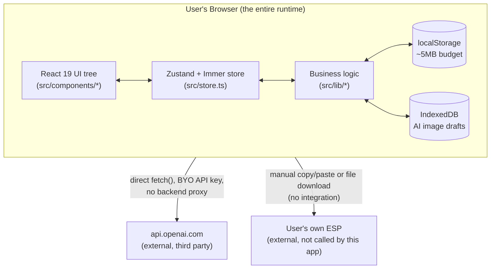
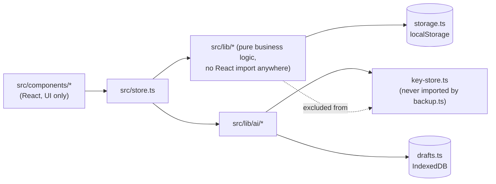
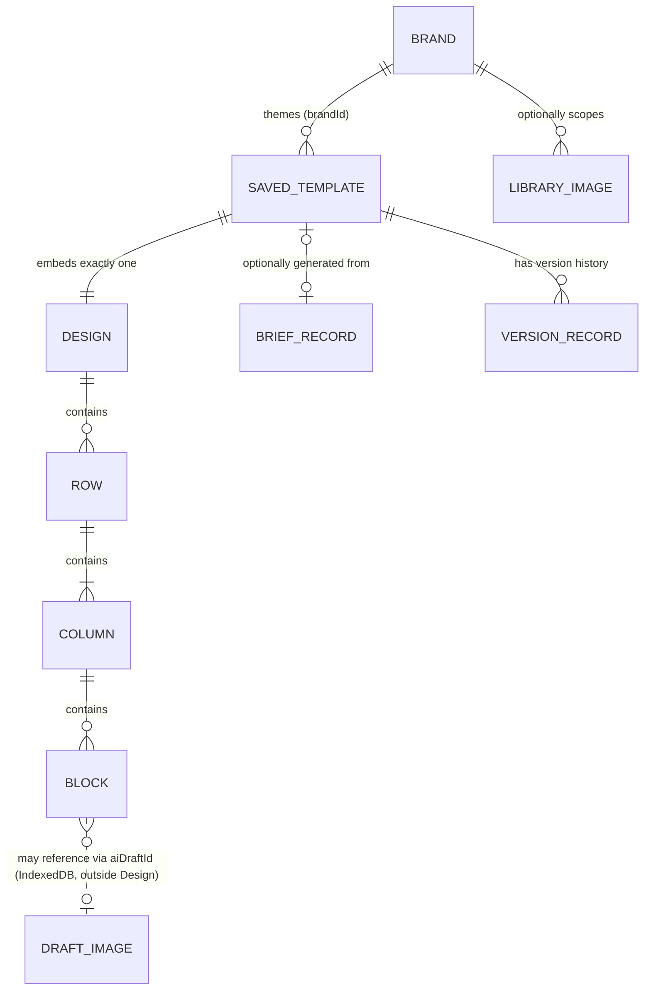

# Newsletter Builder — Technical Requirements Document
## Part 1 of 4 — Sections 1–4: Architecture, Stack, Module Map, Data Model

> Reverse-engineered, read-only, from source code, `docs/PROGRESS.md`, `package.json`, and the existing `docs/brd/` and `docs/prd/`. No source file was changed to produce this document. Tagging convention: **Fact** (default — stated in code/config/tests), **Inference:** (a conclusion drawn from behavior, not stated verbatim), **Not Found in Codebase** (looked for, confirmed absent). See `docs/trd/VERIFICATION_NOTES.md` for every Inference/Not-Found item.

---

## 1. System Architecture Overview

### 1.1 Shape of the system
Newsletter Builder is a **client-only single-page application**. There is no application server, no API gateway, no database server, and no deployed backend process anywhere in this repository. (Fact — confirmed by `vite.config.ts` containing no `server.proxy`/`server` key, and by the complete absence of any server framework — Express, Fastify, Next.js API routes, etc. — in `package.json`.)



### 1.2 Why this shape (Inference, consistent with the explicit design notes in `docs/PROGRESS.md`)
Feature 5A's own development notes record that **browser-callability of the OpenAI API was verified via a live, unauthenticated CORS preflight check before any AI code was written** — `OPTIONS https://api.openai.com/v1/images/generations` returned `access-control-allow-origin: *` with an allow-headers list of exactly `authorization,content-type`. This single fact is architecturally load-bearing: it is *why* the AI features could be built with no backend proxy at all, and it directly constrains the request shape (no `OpenAI-Organization` header, no telemetry header — either would fail the real preflight).

### 1.3 Deployment model
**Not Found in Codebase:** any CI/CD pipeline configuration, Dockerfile, infrastructure-as-code, hosting configuration, or deployment script. `npm run build` (`tsc --noEmit && vite build`) produces a static `dist/` bundle (confirmed present in the working tree at the time of writing) suitable for any static host, but **no evidence exists in this repository for which host, if any, is actually used in practice.**

### 1.4 Runtime dependency graph (external services)
| External dependency | Required for | Failure mode if unreachable |
|---|---|---|
| `api.openai.com` (OpenAI REST API) | AI image generation (F-017 in the PRD), AI brief generation (F-018) | Every other feature continues to work; AI panels show a classified connection error |
| None else | — | — |

---

## 2. Technology Stack & Dependencies

### 2.1 Core stack (Fact — `package.json`)
| Layer | Technology | Version (as installed) |
|---|---|---|
| Language | TypeScript | `^7.0.2` |
| UI framework | React | `^19.3.1` |
| Build tool / dev server | Vite | `^8.3.5` |
| Styling | Tailwind CSS (via `@tailwindcss/vite`) | `^4.3.3` |
| State management | Zustand + Immer | `^5.0.16` / `^11.2.9` |
| Rich text editing | TipTap (`@tiptap/react`, `starter-kit`, `extension-link`, `extension-color`, `extension-text-align`, `extension-text-style`) | `^3.32.0` |
| Drag and drop | `@dnd-kit/core`, `@dnd-kit/sortable`, `@dnd-kit/utilities` | `^6.3.1` / `^10.0.0` / `^3.2.2` |
| HTML sanitization | DOMPurify | `^3.4.17` |
| Icons | `lucide-react` | `^1.62.0` |
| Test runner | Vitest (+ `jsdom` environment) | `^5.0.5` / `^30.1.3` |
| Component testing | `@testing-library/react`, `/dom`, `/user-event` | `^16.3.3` / `^10.4.2` / `^14.6.8` |

### 2.2 Why each major dependency exists (Inference, from usage patterns observed across the BRD/PRD research)
- **Zustand + Immer:** one global store (`src/store.ts`) holding the design, brands, undo/redo stacks, and all transient UI state; Immer lets mutations be written as plain object edits while the store still returns new references for React's change detection.
- **dnd-kit:** powers canvas drag-and-drop (reordering blocks/rows, dragging a left-panel tile onto the canvas, dragging a saved block/row).
- **TipTap:** the Text block's rich-text editor; its extension set is narrow and deliberate (link, color, text-align, text-style) rather than the full starter kit's complete feature surface, matching the editor's actual exposed toolbar.
- **DOMPurify:** sanitizes block HTML before it is painted into the (non-iframe) canvas, which is also why the canvas cannot host a `<style>` block for dark-mode CSS (DOMPurify strips it) — a fact with a direct architectural consequence documented in `docs/PROGRESS.md` Feature 3B.
- **No routing library** (`react-router` or equivalent) is a dependency. **Fact**, confirmed by `package.json`; the application has exactly one route, by construction, not by omission.

### 2.3 Build/type configuration (Fact — `tsconfig.json`, `vite.config.ts`)
| Setting | Value | Technical implication |
|---|---|---|
| `strict` | `true` | Full TypeScript strict-mode checking |
| `noUnusedLocals` / `noUnusedParameters` | `true` | A build fails on dead variables/params |
| `noFallthroughCasesInSwitch` | `true` | Directly relevant to `render.ts`'s large block-type `switch` — an unhandled or fallen-through case fails the build |
| `isolatedModules` / `noEmit` | `true` | `tsc` is type-checking only; Vite/esbuild does the actual transpilation |
| `target` / `module` / `moduleResolution` | `ES2022` / `ESNext` / `bundler` | Modern, Vite-native module resolution |
| `jsx` | `react-jsx` | New JSX transform — no manual `React` import needed per file |
| Vite plugins | `@vitejs/plugin-react`, `@tailwindcss/vite` | React Fast Refresh + first-party Tailwind v4 integration |
| Vitest `environment` | `jsdom` | DOM APIs (including `DOMParser`, used by the renderer's sanitizer) are available under test |
| Vitest `include` | `src/test/**/*.test.{ts,tsx}` | The sole test-file glob — confirms the full test surface lives under `src/test/` |

**Not Found in Codebase:** a separate `tsconfig.node.json`/`tsconfig.app.json` split (one unified `tsconfig.json` governs both app source and `vite.config.ts` itself, per its own `include` list); a dedicated lint script (`tsc --noEmit` is the only static-analysis gate — confirmed by `package.json`'s `scripts` block having no `lint` entry).

---

## 3. Project & Module Structure

### 3.1 Top-level layout (Fact)
```
src/
  main.tsx              entry point; first-run seeding (Welcome preset + Vee brand)
  App.tsx               root layout, keyboard shortcuts, auto-save/checks side effects
  store.ts              the one Zustand+Immer store — every mutation goes through it
  types.ts              the full Design/Block/Brand type system
  index.css             Tailwind entry + canvas-mirrored CSS (e.g. .eb-col, .eb-hide-mobile)
  components/           every screen, modal, panel, and property editor (flat, plus settings/)
  lib/                  all business logic — no React imports anywhere in this directory
  lib/ai/               the AI subsystem — providers, key storage, task routing, brief pipeline
  test/                 41 test files, one Vitest config (via vite.config.ts), jsdom environment
```

### 3.2 `src/lib/*` — responsibility map (Fact, one line each, file names exact)
| File | Responsibility |
|---|---|
| `defaults.ts` | Block-type defaults, `BLOCK_META`, `ROW_LAYOUTS`, font stacks |
| `design-ops.ts` | Tree lookups (`findBlock`/`findColumn`/`findRowIndex`), `applyRowLayout`, `normalizeDesign` (the one JSON-load gate) |
| `render.ts` | The single HTML generator — canvas and export share it |
| `output.ts` | The export pipeline boundary (`resolveForOutput`): brand resolve → AI-draft placeholder swap → UTM → merge-tag format |
| `brand.ts` | Brand CRUD helpers, token resolution, `resolveBrand`, `canEditBrand`/`getAccessibleBrands` (permission seams) |
| `dark.ts` | Dark-palette derivation, token-vs-literal diffing, class minting |
| `presets.ts` | The 8 starter preset definitions (`Preset.build(brand): Design`) |
| `merge.ts` | Canonical `{{tag}}` storage, the 4 ESP output-format tables |
| `utm.ts` | UTM tagging rules and skip conditions |
| `plaintext.ts` | HTML-design-to-plain-text conversion |
| `blocks-library.ts` | Saved-block/row validation, cloning, import planning |
| `versions.ts` | Pure version-history rules (snapshot/dedup/prune), no storage I/O |
| `storage.ts` | All `localStorage` reads/writes, `writeSafe()` quota recovery, schema versioning |
| `image.ts` | User-uploaded logo/image downscaling (unrelated to AI image generation) |
| `image-storage.ts` | The URL-based image library — validation, probing, the storage adapter interface |
| `image-audit.ts` | Design-level image collection and resolution-threshold notes |
| `audit.ts` | Placeholder-image URL pattern detection |
| `checks.ts` | The quality-rule engine — `checkDesign()` → `Issue[]` |
| `contrast.ts` | Pure WCAG 2.1 contrast math |
| `drafts.ts` | AI-generated image byte storage (IndexedDB abstraction) |
| `backup.ts` | Full-data export/import, deliberately excluding AI keys/drafts |
| `clear-all.ts` | The one function allowed to delete AI keys and drafts, for wipe purposes |
| `email-defaults.ts` | Org-wide defaults applied only at new-email creation |
| `user.ts` | The local, unauthenticated "profile" display name |
| `util.ts` | `uid()`, `slugify()`, `downloadFile()`, `safeUrl()` |

### 3.3 `src/lib/ai/*` — responsibility map (Fact)
| File | Responsibility |
|---|---|
| `provider.ts` | Shared image-provider contract, `AiError` type, `redactKeys()`, size/time limits |
| `openai.ts` | OpenAI image-generation adapter — request shape, size selection, error classification |
| `openai-text.ts` | OpenAI text/structured-output adapter |
| `text-provider.ts` | Shared text-provider contract |
| `validate.ts` | Image-response byte validation (magic bytes, size cap, base64, PNG dimensions) |
| `key-store.ts` | API key storage (memory/localStorage), remember toggle, connection status |
| `styles.ts` | Image style-preset suffixes |
| `tasks.ts` | The 2-entry task registry (`text.brief`, `image.generate`) |
| `task-settings.ts` | Per-task routing persistence, fallback chains, one-time migration |
| `run-task.ts` | The single call-site function — routing, per-task guard, fallback-on-error |
| `model-access.ts` | Session-only, per-task "model access denied" signal |
| `text-consent.ts` | Per-provider consent-granted flag for sending brief text to a text provider |
| `slots.ts` | The slot-derivation pattern — classifies a preset's block tree into AI-fillable fields |
| `brief-types.ts` | `BriefFields`/`BriefRecord` shapes and defaults |
| `brief-prompt.ts` | System/user prompt construction, prompt-injection framing |
| `brief-schema.ts` | Strict-mode JSON Schema builder for the brief response |
| `brief-validate.ts` | Sanitization + shape/limit validation of the AI response |
| `create-from-brief.ts` | Orchestration: generate draft → write onto design |
| `preset-selection.ts` | Auto preset resolution by brief goal |

### 3.4 Module dependency direction (Inference, drawn from the import graph implied by the responsibility maps above)

The one architecturally enforced exclusion worth diagramming explicitly: `backup.ts` **never imports** `key-store.ts` or `drafts.ts` — a structural (not just behavioral) guarantee that a full-data export cannot reach either, confirmed by reading that file's own import list rather than by testing its runtime output alone.

---

## 4. Data Model & Type System

All of the following interfaces are quoted directly from `src/types.ts` (field sets condensed to the technically load-bearing ones; optional/derived fields noted).

### 4.1 The design tree
```ts
interface Design {
  version: 1;
  brandId: string | null;
  body: BodySettings;
  rows: Row[];
}

interface Row {
  id: string;
  layout: number[];           // column ratios, e.g. [1, 2]
  bgColor: string;            // the ONLY background that can span the full window
  contentBgColor: string;
  padding: Padding;
  stackOnMobile: boolean;
  dark?: DarkOverrides;        // manual per-row dark override
  columns: Column[];
}

interface Column {
  id: string;
  blocks: Block[];
}
```

### 4.2 `Block` — a discriminated union, 13 types
```ts
type BlockType =
  | 'heading' | 'text' | 'image' | 'button' | 'divider'
  | 'menu' | 'social' | 'video' | 'html'
  | 'header' | 'hero' | 'footer' | 'articles';

interface Block {
  id: string;
  type: BlockType;
  values: /* one of 13 type-specific *Values shapes, each also carrying
             padding: Padding and an optional dark?: DarkOverrides */;
}
```
Several `*Values` shapes additionally carry `aiDraftId?: string` (a pointer to a locally-generated image held in this browser's IndexedDB — never image bytes) and/or `noTrack?: boolean` (a per-link UTM opt-out).

### 4.3 Email-wide settings
```ts
interface BodySettings {
  bgColor: string; contentBgColor: string; width: number; fontFamily: string;
  textColor: string; linkColor: string; preheader: string; title: string;
  showFooter: boolean;
  mergeFormat: 'curly' | 'mailchimp' | 'hubspot' | 'custom';
  mergeCustom: { prefix: string; suffix: string };
  utm: UtmSettings;
  darkMode: boolean;
}

interface UtmSettings {
  enabled: boolean; source: string; medium: string; campaign: string;
  content: string; term: string;
}
```

### 4.4 Brand kit
```ts
interface Brand {
  id: string; name: string; slug: string;
  logo: string; logo_dark: string;           // uploaded, canvas-preview only
  logo_url: string; logo_dark_url: string;   // hosted https, the ONLY thing exports use
  website_url: string;
  tokens: BrandTokens;
  darkTokens: BrandDarkColors | null;        // null = "derive one"
  voice: BrandVoice | null;                  // null = "no voice guidance set"
  footer: BrandFooter;
  social_links: BrandSocialLink[];
  is_active: boolean;
  createdAt: number; updatedAt: number;
  createdBy: string | null; updatedBy: string | null;  // local display-name label, not auth
  schemaVersion: number;
}

interface BrandTokens {
  colors: { primary: string; secondary: string; accent: string; text: string;
            muted: string; link: string; page_bg: string; content_bg: string; border: string };
  fonts: { heading: string; body: string };
  button: { radius: number; paddingV: number; paddingH: number;
            weight: 'normal' | 'bold'; uppercase: boolean };
}

interface BrandDarkColors {
  page_bg: string; content_bg: string; text: string; muted: string;
  link: string; border: string; button_bg: string; button_text: string;
}

interface BrandVoice {
  description: string; wordsToUse: string[]; wordsToAvoid: string[];
}
```

### 4.5 Editor-only / selection state
```ts
type Selection = { kind: 'body' } | { kind: 'row'; id: string } | { kind: 'block'; id: string };
type Device = 'desktop' | 'mobile';
type Scheme = 'light' | 'dark';
```

### 4.6 Records defined outside `types.ts` (Fact — storage/library modules)
| Type | Defined in | Notes |
|---|---|---|
| `SavedTemplate` | `src/lib/storage.ts` | `{ id, name, updatedAt, createdAt, brandId, design: Design, autoSaved: boolean, createdBy, updatedBy, schemaVersion, brief: BriefRecord \| null }` |
| `SavedBlock` | `src/lib/blocks-library.ts` | `{ id, name, category, kind: 'block' \| 'row', payload: Block \| Row, createdAt, updatedAt, schemaVersion }` |
| `LibraryImage` | `src/lib/image-storage.ts` | `{ id, url, name, defaultAlt, tags[], width, height, brandId: string \| null, createdAt, status: 'ok' \| 'broken' \| 'unknown', checkedAt, schemaVersion }` |
| `VersionRecord` | `src/lib/versions.ts` | `{ id, emailId, at, note, reason, rows, blocks, design: Design, schemaVersion }` — never includes a `Brand` |
| `BriefRecord` | `src/lib/ai/brief-types.ts` | `{ fields: BriefFields, resolvedPresetId, reviewed: boolean, generatedAt }` |

### 4.7 Entity relationships

