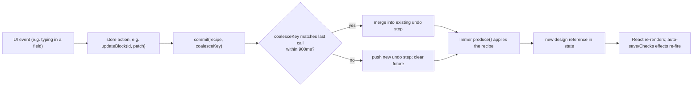
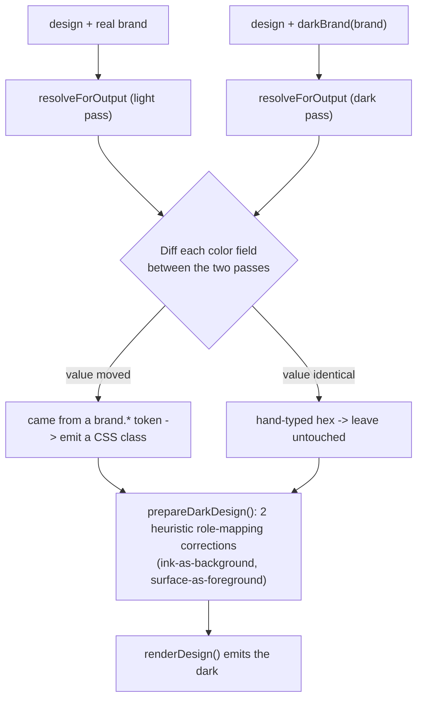

# Newsletter Builder — Technical Requirements Document
## Part 2 of 4 — Sections 5–8: State Management, Rendering Pipeline, Persistence, Quality Engine

> Continues from `TRD-01-architecture.md`.

---

## 5. State Management (Zustand Store)

### 5.1 Store shape (Fact — `src/store.ts`)
One store, `useEditor`, created via `zustand` + `immer`'s `produce`. Selected state fields:

| Field | Type | Purpose |
|---|---|---|
| `design` | `Design` | The currently edited email |
| `brands` | `Brand[]` | Every brand on this browser, archived included |
| `past` / `future` | `Design[]` | Undo/redo stacks, capped at `HISTORY_LIMIT = 100` |
| `selection` | `Selection` | Current editor selection |
| `device` / `scheme` | `Device` / `Scheme` | Canvas preview toggles |
| `revision` | `number` | Bumped on any whole-design **load** (open/restore/undo) — the signal auto-save uses to distinguish a load from an edit |
| `currentEmailId` | `string \| null` | The saved-email record this canvas belongs to; `null` until first save |
| `dirty` | `boolean` | A change the debounce has not yet written |
| `saveState` | `{status, at, message}` | Top-bar save status, never silently idle after a failure |
| `savedBlocks` / `images` | `SavedBlock[]` / `LibraryImage[]` | The two reusable libraries |
| `issues` / `ignoredIssues` | `Issue[]` / `string[]` | Checks engine output and per-email dismissals |
| `knownDrafts` / `draftsChecked` | `string[]` / `boolean` | Which AI-draft ids this browser actually holds |
| `currentBrief` | `BriefRecord \| null` | The brief this email was generated from, if any |

### 5.2 The mutation gateway
Every structural/value mutation flows through an internal `commit(recipe, coalesceKey?)` helper, which:
1. Applies the recipe via Immer's `produce()` — mutations are written as plain edits, the result is a new, referentially-distinct object.
2. Pushes the **previous** design onto `past` (capped, oldest dropped past 100) and clears `future`.
3. If `coalesceKey` matches the previous call's key within `COALESCE_MS = 900`ms, merges into the existing undo step instead of creating a new one.



### 5.3 Brands are explicitly outside undo history
Brand writes (`upsertBrand`, `duplicateBrand`, `setBrandArchived`) go through `writeBrands()` → `set({brands: next})` directly, never through `commit()` — a documented, deliberate exception, since brands are shared state across every email in the browser, not scoped to the currently edited document.

---

## 6. Rendering & Export Pipeline

### 6.1 One renderer, two consumers
`renderBlock()`/`renderBlockInner()` in `src/lib/render.ts` is the **single** source of HTML for both the live canvas and every export path. This is enforced by construction — there is exactly one function, not two implementations kept in sync by convention.

### 6.2 The export boundary
```ts
// src/lib/output.ts — resolveForOutput(), simplified to its actual call order
function resolveForOutput(design: Design, brand: Brand, mode: 'export' | 'preview', opts?) {
  let out = resolveDesign(design, brand, mode);   // brand tokens -> literals
  out = substituteDraft(out, opts?.draftImages);   // aiDraftId -> placeholder URL (or real bytes, canvas/preview only)
  if (mode === 'export') out = addUtm(out, design.body.utm); // export-only
  out = formatMergeTags(out, design.body.mergeFormat);
  return out; // caller then calls renderDesign() and/or toPlainText()
}
```
**Order is load-bearing:** UTM tagging runs while merge tags are still canonical `{{tag}}`, so "is this URL nothing but a merge tag" stays one regex rather than a per-ESP-format problem.

### 6.3 Dark-mode double-resolve

With `body.darkMode` false, `darkRenderOpts()` returns `{}` and no dark machinery runs at all — this single branch is why the byte-identical-export guarantee (checked by snapshot tests) holds.

### 6.4 Normalization — the one JSON-load gate
`normalizeDesign(input: unknown): Design | null` (`src/lib/design-ops.ts`) is reused by every entry point that reads untrusted/stored JSON: `storage.ts` (draft/template load), `versions.ts` (version load), `backup.ts` (restore). It returns `null` only if `input.rows` is not an array; otherwise unknown block types are silently dropped, missing fields are filled from `createBlock(type)` defaults, and known pre-feature migrations are applied explicitly (e.g. a design with no `showFooter` gets `true`; no `darkMode` gets `true`).

---

## 7. Persistence Layer

### 7.1 `localStorage` key inventory (Fact — confirmed against `src/lib/storage.ts` and the AI subsystem's own storage modules)

| Key | Schema version field | Contents |
|---|---|---|
| `email-builder:draft:v1` | n/a (legacy) | Pre-2B single "open email" slot; migrated once then deleted |
| `email-builder:templates:v1` | `SavedTemplate.schemaVersion` | Every saved/auto-saved email |
| `email-builder:brands:v1` | per-`Brand.schemaVersion` (currently 3) | All brand kits |
| `email-builder:sample:v1` | none | Merge-tag preview sample values — editor-only, never in the `Design` |
| `email-builder:blocks:v1` | `SavedBlock.schemaVersion` (currently 2) | Saved-block/row library |
| `email-builder:versions:v1` | `VersionRecord.schemaVersion` | All version snapshots, every email, one key (so quota-pruning can free space globally) |
| `email-builder:session:v1` | stamped | `{ lastEmailId }` — which email to reopen on next load |
| `email-builder:images:v1` | `LibraryImage.schemaVersion` (currently 2) | Image library |
| `email-builder:ignored:v1` | stamped | `{ byEmail: Record<emailId, string[]> }` — dismissed Checks issue ids |
| `email-builder:profile:v1` | stamped (currently 1) | `{ name, hintShown }` — local display-name identity |
| `email-builder:email-defaults:v1` | stamped (currently 1) | Org-wide new-email defaults |
| `email-builder:aikeys:v2` (+ legacy `:v1`, migrated once) | `KEY_SCHEMA` (currently 2) | `{ activeProviderId, byProvider: { [id]: { model, key } } }` — opt-in only |
| `email-builder:ai-task-routing:v1` | stamped (currently 1) | Per-task provider/model/options/fallback-chain config — **never a key** |
| `email-builder:ai-text-consent:v1` | none | Provider ids the user has consented to send brief text to |

IndexedDB: database `email-builder-drafts`, object store `images`, keyed by id — holds `DraftImage { id, blob, mime, width, height, prompt, alt, model, createdAt }` (AI-generated image bytes; `memoryDraftStore()` substitutes a `Map` under test, selected via `typeof indexedDB === 'undefined'`).

### 7.2 Quota recovery
```ts
// src/lib/storage.ts — writeSafe(), the only writer anything outside this module should use
type WriteResult = 'ok' | 'pruned' | 'full';
function writeSafe(key: string, value: unknown): WriteResult {
  if (write(key, value)) return 'ok';
  const pruned = pruneOldestGlobal(listVersions(), QUOTA_PRUNE_COUNT /* = 10 */);
  if (pruned.length && write(VERSIONS_KEY, pruned) && write(key, value)) return 'pruned';
  return 'full';
}
```
`STORAGE_LIMIT_BYTES = 5 * 1024 * 1024` is a constant used only for the UI's usage readout — the real browser-enforced cap is not read programmatically (no API exposes it) and is only approximated. `storageUsage()` sums `(key.length + value.length) * 2` bytes (UTF-16 code units — what the quota is actually measured in) over every `email-builder:`-prefixed key.

### 7.3 Backup/restore, and the structural secret-exclusion guarantee
`backup.ts`'s `BackupData` covers exactly `{ brands, templates, savedBlocks, images, versions }`. The guarantee that the AI key store and drafts can never leak through a backup is **structural**: the file never imports `key-store.ts` or `drafts.ts` at all — a property verifiable by reading its import list, not merely by testing its output. `importBackup()` normalizes every record through the same `normalize*()` function its category's normal load path uses; a record that fails to normalize is dropped, not a reason to reject the whole import.

### 7.4 Schema versioning discipline
Each persisted category keeps its **own** independent version counter (`SCHEMA_VERSION` for templates = 2, `BRAND_SCHEMA_VERSION` = 3, `SAVED_BLOCK_SCHEMA` = 2, `IMAGE_SCHEMA` = 2) — not one global app-wide version. A record with no `schemaVersion` field is treated as version 1 and kept (never discarded for being old); every `normalize*()` function fills missing fields from current defaults rather than rejecting the record.

---

## 8. Business Rule / Quality Engine

### 8.1 Entry point
```ts
// src/lib/checks.ts
function checkDesign(
  resolvedDesign: Design,   // already brand-resolved, UTM-tagged, merge-formatted
  exportedHtml: string,     // the real rendered output
  brand: Brand,
  opts: { knownDrafts?: string[]; probedImages?: Record<string, 'ok'|'broken'> },
): Issue[]
```
Passing the **unresolved** design is documented in-code as a caller bug, not a condition the engine itself guards against at runtime.

### 8.2 Rule catalogue (Fact — exact codes, thresholds, and severities)
| Group | Code | Severity | Condition |
|---|---|---|---|
| SIZE | `SIZE_NEAR_LIMIT` | warning | ≥ 90 KB (UTF-8 bytes of the real HTML) |
| SIZE | `SIZE_OVER_LIMIT` | error | ≥ 102 KB |
| SIZE | `SIZE_DARK_OVERHEAD` | warning | dark-mode CSS/markup adds > 3 KB, measured by double-rendering |
| SUBJECT | `SUBJECT_EMPTY` | error | `body.title` blank |
| SUBJECT | `SUBJECT_LONG` | info | > 60 chars |
| PREHEADER | `PREHEADER_EMPTY` | warning | `body.preheader` blank |
| PREHEADER | `PREHEADER_LONG` | info | > 110 chars |
| UNSUBSCRIBE | `UNSUBSCRIBE_MISSING` | warning | no "unsubscribe" string (any ESP format) found in the HTML |
| CONTENT | `CONTENT_THIN` | warning | < 20 visible words **and** ≥ 1 image |
| CONTRAST | `CONTRAST_TEXT` / `CONTRAST_BUTTON` / `CONTRAST_LINK` | error | WCAG AA not met against the effective background |
| CONTRAST | `CONTRAST_UNKNOWN` | info | text sits on a hero background image — unmeasurable, reported as such rather than guessed |
| CONTRAST (dark) | `CONTRAST_TEXT_DARK` / `CONTRAST_BUTTON_DARK` / `CONTRAST_LINK_DARK` | error | same AA check, run a second time on the dark-resolved design |
| READABILITY | `TEXT_TOO_SMALL` | warning | font-size < 12px |
| READABILITY | `TAP_TARGET_SMALL` | warning | effective button height < 44px |
| LINKS | `LINK_EMPTY` / `LINK_HASH` / `LINK_RELATIVE` | error | no href / `#` / relative URL |
| LINKS | `LINK_HTTP` | warning | `http://` not `https://` |
| LINKS | `LINK_PLACEHOLDER_DOMAIN` | warning | host matches example.com/example.org/example.net/yourdomain.com/yoursite.com/yourcompany.com or a subdomain |
| IMAGES | `IMAGE_EMBEDDED` / `IMAGE_NOT_HTTPS` | error | `data:` URI / not https |
| IMAGES | `IMAGE_BROKEN` | error | **only** once the URL has been actively probed and failed |
| IMAGES | `IMAGE_PLACEHOLDER` | warning | matches the known placeholder-domain pattern list |
| IMAGES | `IMAGE_MISSING_ALT` | warning | the field has an alt attribute slot and it is blank |
| IMAGES | `IMAGE_TOO_WIDE` | warning | natural width > 1600px (requires the image to be in the library, where natural size is measured) |
| DARK | `DARK_NO_LOGO` | info | the email uses a logo and the brand has no `logo_dark_url` |
| DARK | `DARK_IMAGE_MANUAL` | info | a hero centered background image, which dark mode cannot restyle |
| AI image | `AI_IMAGE_MISSING_DRAFT` / `AI_IMAGE_NOT_HOSTED` | error | an `aiDraftId` not present locally / present but nowhere public |
| AI brief | `AI_DRAFT_UNREVIEWED` | warning | a brief-generated email not yet marked reviewed |
| AI brief | `BRIEF_PLACEHOLDER_LEFT` | warning | a `[bracketed placeholder]` still present in copy |

### 8.3 Stable issue identity
```ts
const id = `${code}#${blockId ?? 'email'}#${discriminator}`;
```
The same underlying problem keeps the same `id` across unrelated edits and across runs, which is the technical precondition for "Ignore" to mean anything persistent rather than coincidentally matching a re-computed list.

### 8.4 Contrast math (pure, independently testable)
`src/lib/contrast.ts`: sRGB → linear RGB → relative luminance → contrast ratio (range 1–21). "Large text" = font-size ≥ 24px, or ≥ 18.66px **and** bold. Required ratio: 4.5:1 normal, 3:1 large. `suggestFix()` walks the foreground color toward black or white (whichever direction increases contrast) in fixed steps until the threshold clears, which is the mechanical source of a concrete "Try #919191"-style suggestion in the UI.
