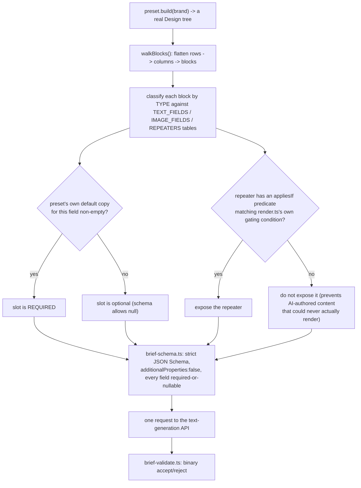

# Newsletter Builder — Technical Requirements Document
## Part 3 of 4 — Sections 9–11: AI Integration, Component Architecture, Build & Test Tooling

> Continues from `TRD-02-runtime-and-persistence.md`.

---

## 9. AI Integration Architecture

### 9.1 Request shape — image generation
```ts
// src/lib/ai/openai.ts — the ONLY two headers ever sent, confirmed against a
// live CORS preflight before this adapter was built
headers: {
  Authorization: `Bearer ${key}`,
  'Content-Type': 'application/json',
}
body: { model, prompt, size, n: 1, output_format: 'png', quality? } // quality omitted entirely when unset
```
`response_format` is never sent (deprecated/unsupported for GPT image models — the response is always base64 `data[].b64_json`, so there is never a second cross-origin fetch of a returned URL). `REQUEST_TIMEOUT_MS = 90_000`, honoring both an internal timer and the caller's own `AbortSignal`.

### 9.2 Size selection logic
```ts
function sizeFor(aspect: AspectChoice, blockWidth: number, model: string): string {
  const arbitrary = /^gpt-image-2(\.\d+)?(-|$)/.test(model); // "arbitrary size" model family
  switch (aspect) {
    case '1:1': return '1024x1024';
    case '3:2': return '1536x1024';
    case '16:9': return arbitrary ? '1536x864' : '1536x1024';
    case '4:3':  return arbitrary ? '1360x1024' : '1536x1024'; // 1360 = nearest multiple of 16 to true 4:3
    case 'match': /* infer from blockWidth: >=480 landscape, <220 portrait (1024x1536), else square */
  }
}
```
The `1360` constant is the fix for a real, previously-shipped bug: an earlier `1365x1024` value is not divisible by 16, which is a documented OpenAI constraint for this model family (both sides ÷16, ratio 1:3–3:1, 3840×2160 ceiling) — every 4:3 request silently failed and fell back to 3:2 until this was corrected.

### 9.3 Error classification (closed set)
```ts
type AiErrorKind =
  | 'invalid-key' | 'forbidden' | 'no-credit' | 'rate-limit'
  | 'content-policy' | 'network' | 'timeout' | 'bad-response' | 'cancelled';
```
| Response | Classification |
|---|---|
| HTTP 401 | `invalid-key` |
| HTTP 403 | `forbidden` |
| HTTP 429 + `insufficient_quota` | `no-credit` |
| HTTP 429, otherwise | `rate-limit` |
| HTTP 502/503/504/524 | `network` (message explicitly warns the request "may well have been made and billed") |
| Body/code containing `content_policy`/"safety system"/"moderation" | `content-policy` |
| An HTML body where JSON was expected | `bad-response` ("a proxy or firewall returned a web page") |
| Empty body | `bad-response` |
| Anything else ≥500 | `network` |
| `DOMException('AbortError')` | `cancelled` |

A second, narrower check (`isModelAccessError()`) recognizes a model-access denial from either a `403` **or** message text matching `/do(?:es)? not have access|access to (this |the )?model|model_not_found/i` — added because some providers answer an inaccessible model with a generic 404 that `classify()` would otherwise bucket as plain `bad-response`.

### 9.4 Key handling — the security-relevant implementation detail
```ts
// src/lib/ai/key-store.ts
const memory = new Map<string, StoredEntry>();  // default: dies with the tab
// "Remember on this device" (opt-in, per provider) persists into:
//   localStorage: email-builder:aikeys:v2
// redactKeys(text, key) strips: the exact key (>=8 chars), any
//   sk-/rk-/org-/proj- prefixed token, and any "Bearer <token>" pattern,
// applied to every provider-echoed error string before it reaches the UI.
```
**Deliberately not in the Zustand store.** Every field in that store is a candidate for JSON serialization (designs, brands, saved blocks, and version snapshots all round-trip through it); keeping the key out of it structurally prevents any future feature that forgets this rule from accidentally writing it out. This guarantee is swept by dedicated tests across every serialization surface: the design, brands, saved blocks, image library, issues, the rendered export string, every `localStorage` entry, and `document.body.textContent`.

### 9.5 Per-task routing and fallback
```ts
type AiTaskId = 'text.brief' | 'image.generate';
type TaskRoute = { providerId: string; model: string; options: object; fallbacks: FallbackEntry[] };

// src/lib/ai/run-task.ts — the one call-site function
const FALLBACK_TRIGGER = new Set(['network', 'timeout', 'rate-limit']);
async function runTask<T>(taskId: AiTaskId, input): Promise<T> {
  for (const candidate of candidatesFor(taskId)) {          // primary, then each fallback in order
    if (!candidate.isConnected) continue;                    // skip: no key, or not proven this session
    try { return await candidate.call(input); }
    catch (err) {
      if (!FALLBACK_TRIGGER.has(classify(err))) throw err;    // bad key/content-policy/etc. stop immediately
      // else: try the next candidate
    }
  }
  throw lastError;
}
```
A per-task, module-level `guards: Map<AiTaskId, GuardState>` enforces one in-flight call per task plus a shared `MIN_REQUEST_GAP_MS = 2_000` floor between consecutive calls for the same task.

### 9.6 Brief-generation pipeline — the "slot-derivation pattern"

The `appliesIf` gate (step G/I) is a fix for a real, previously-shipped bug: `createBlock('hero')` always populates a default 2-item `cards` array regardless of layout, but `render.ts` only draws it for `layout: 'cards-2'/'cards-3'` — the first version of the slot-derivation code exposed that array as an AI-fillable field whenever non-empty (i.e. always), which would have asked the model to write hero-card copy that could never render for 7 of the 8 presets. The fix replicates the exact condition `render.ts` itself checks, rather than a weaker "is this field non-empty" test.

### 9.7 Prompt-injection defense
1. The brief and any pasted source text are each wrapped in `===== BEGIN/END <name> (untrusted data) =====` delimiters, with an explicit system-prompt instruction to treat their contents as data, never instructions.
2. A mechanical backstop: the strict JSON Schema (`additionalProperties: false`, every field required-or-nullable) constrains the model's output shape at the token level — injected text cannot add fields or escape the schema regardless of what it asks for.

---

## 10. Component Architecture

### 10.1 Top-level composition (Fact — `src/App.tsx`)
```tsx
<ConfirmProvider>
  <TopBar />
  <DndShell>
    <LeftPanel />
    <Canvas />
  </DndShell>
  {aiTarget ? <AiImagePanel /> : <RightPanel />}
  <ChecksPanel />
  {/* modals rendered conditionally by a ModalName union, not a router */}
</ConfirmProvider>
```
There is no `react-router` and no history-API usage anywhere — confirmed by grep across `src/components/`. Every "screen" is a modal (`Modal` wrapper in `Modals.tsx`), an overlay (`ChecksPanel`), or a panel swap (`AiImagePanel` replacing `RightPanel`; `SettingsHub` replacing `LeftPanel`'s tab content).

### 10.2 Cross-component communication without prop-drilling or a router
A recurring pattern: a deeply nested component (e.g. an `ImageUrlField` three levels inside a block editor) needs to open a top-level panel without a prop path connecting them and without a new store slice. The solution used consistently across the codebase is a **module-level callback registry**:
```ts
// src/components/fields.tsx (5A) — reused verbatim by settings-nav.ts (6B)
let openImpl: ((target: X) => void) | null = null;
export function registerXOpener(fn: typeof openImpl) { openImpl = fn; }
export function openX(target: X) { openImpl?.(target); }
```
`App.tsx` registers the real implementation once on mount; any component anywhere can call the exported `openX()` function directly. `LeftPanel.tsx` re-registers its settings-opener on every active-tab change specifically so a later external "Open AI settings" call restores the *current* tab rather than a stale one captured at mount.

### 10.3 The "shared component, two mount points" pattern
`AiImagePanel.tsx` exports `SettingsView` as a named export; `AiSection.tsx` (inside the Settings hub) mounts that exact same component — not a reimplementation — so the AI image panel's own gear icon and Settings → AI are provably the same code and the same `key-store.ts` module state, never two copies that could drift apart.

### 10.4 Rendering parity between canvas and export
The canvas does **not** render inside an iframe — block HTML is sanitized via DOMPurify and painted into divs. This has a direct, documented architectural consequence: DOMPurify strips `<style>` tags, so the canvas cannot host the dark-mode stylesheet, which is why the Light/Dark toggle only drives the **Preview** modal (which *is* a sandboxed iframe containing the literal exported HTML) and why the canvas itself is "always light," by construction, not by an unfinished feature.

---

## 11. Build, Test & Tooling

### 11.1 Scripts (Fact — `package.json`)
| Script | Command | Purpose |
|---|---|---|
| `dev` | `vite` | Dev server |
| `build` | `tsc --noEmit && vite build` | Type-check, then production bundle to `dist/` |
| `preview` | `vite preview` | Serve the production build locally |
| `test` | `vitest run` | Full test suite, single run (no watch) |
| `typecheck` | `tsc --noEmit` | Type-check only |
| `docs:pdf` | `node scripts/docs-to-pdf/index.mjs docs/brd` | Renders `docs/brd/` to a PDF (this project's own documentation tooling — see `TRD-04`) |

**Not Found in Codebase:** a `lint` script, a `format` script, or a pre-commit hook configuration (no `.husky/`, no `lint-staged` config found).

### 11.2 Test suite inventory (Fact — run fresh for this document, not quoted from memory)
`npm test` → **41 test files, 950 tests, all passing** (70.46s). `npx tsc --noEmit` → **0 errors.** Full file list (`src/test/*.test.{ts,tsx}`):
```
acceptance-2b.test.ts        ai.test.ts                   ai-draft-render.test.tsx
ai-model-access.test.ts      ai-providers.test.tsx        ai-run-task.test.ts
ai-tasks.test.ts             ai-task-settings.test.ts     ai-task-ui.test.tsx
ai-ui.test.tsx               app.test.tsx                 backup.test.ts
blocks.test.ts               brand.test.ts                brief-checks.test.ts
brief-generate.test.ts       brief-misc.test.ts           brief-orchestrate.test.ts
brief-slots.test.ts          brief-storage.test.ts        brief-store.test.ts
brief-validate.test.ts       checks.test.ts               contrast.test.ts
dark.test.ts                 dnd.test.ts                  email-defaults.test.ts
image-audit.test.ts          image-library.test.ts        merge.test.ts
plaintext.test.ts            presets.test.ts              profile-settings.test.tsx
render.test.ts                rte.test.tsx                 saved-blocks.test.ts
storage.test.ts               store.test.ts                 user.test.ts
utm.test.ts                   versions.test.ts
```

### 11.3 Test technique worth noting
`storage.test.ts`'s quota-path coverage stubs `Storage.prototype.setItem` to throw `QuotaExceededError` a controlled number of times, proving the prune-then-retry sequence in `writeSafe()` genuinely recovers rather than merely being read as correct from the source. `ai.test.ts`/`ai-*` files stub `fetch` entirely — **no test anywhere makes a real network call to OpenAI**, confirmed by the suite passing with no API key configured in this environment.

### 11.4 Known test-suite performance note (Fact, from the suite's own output)
```
Environment  jsdom was created 41 times · 76% of tracked time
             create it once per worker with pool: 'vmThreads' (keeps per-file
             isolation) or isolate: false (shares it across files)
```
This is Vitest's own advisory output, not a failure — the suite passes in full; it is a possible future speed improvement, not a current defect.
